> [!info] Provenance — read this before treating anything here as open
> Jon's field report from the August 2026 portfolio roadtrip, dropped into `05-Inbox/` on 2026-09-02 and filed here the same day. It is the **third** record of this one trip, and the other two came first:
>
> 1. **The 27 filed transcripts** in this folder, harvested 2026-08-31 into 150 unassigned rows (`TD-0039` to `TD-0188`) in [[10-Business/eos/to-dos]] and the 331 property rows in [[60-Communities/open-items]].
> 2. **The road-trip tracker** (`Parakeet Week in Review.docx` lineage), folded in 2026-09-01 and retired to `99-Archive/2026-08-southeast-tour/`.
>
> **The blockquoted items in this report are condensed from those same 27 transcripts**, so they are already in the registers. Filing them again would have duplicated the August harvest. **What was new on 2026-09-02 is the plain-list site punch list, Jon's 29 field photos, the eight portfolio-wide themes, and the RM/Fund attribution** — and only those were routed. See `00-Meta/audit-log.md` for the row-by-row record.
>
> Greene Pointe appears in this report and in no register before it.

# 2026 Portfolio Roadtrip Report

**Parakeet Communities | Portfolio Operations**

Field observations from the August 2026 portfolio-wide site visits, organized by community.

| | |
|---|---|
| As of | September 2, 2026 |
| Source | Site punch list + AI notetaker summaries, Aug 17-23, 2026 |
| Coverage | 32 communities, 3 regions |
| Items logged | 329 |
| Field photos | 29 |
| Open decisions | 85 |
| Safety flags | 26 |

Flag key: `SAFETY` immediate risk. `OPEN DECISION` discussed, never resolved. `BUDGET ITEM` named for next year. `WIN` working well.

Plain list items are the site punch list, verbatim. Blockquoted items are condensed from the notetaker summaries of the same visits.

---

## Portfolio-Wide Themes

Patterns that showed up at enough communities to be treated as one decision rather than twenty.

**CENTRALIZE LANDSCAPING.** Maintenance is currently the resident's or landlord's responsibility and results are inconsistent, driven by landlord negligence and by older owners who physically cannot do the work. Proposal is to bundle mowing and trimming into rent for rental properties, which given the number of landlords would change appearance immediately, and to issue homeowners a direct choice: trim it or we remove it. This moves enforcement from reactive penalties to a proactive service model and helps residents who cannot do the work. `OPEN DECISION`

**MAILBOX STRUCTURES.** The single most repeated item on the trip, appearing at 14 communities: Hershey Park, Oakside, Parkwood, McGregor Downs, Fox Creek, Auburn Ridge, Regency I, Shady Acres, Belle Haven, The Oaks, Terrace Crossings, Riverwalk, Paradise Palms, Royal Palm and Everglades. Shady Acres and Druid Oaks both proposed the same standard: uniform white PVC single mailboxes with reflective numbering, pending post office consultation. Lucky Clover and Fox Creek both want glass-enclosed bulletin boards at the mailbox clusters. Treating this as one portfolio-wide spec and bulk purchase is the obvious move.

**INDIVIDUAL TRASH CANS OVER DUMPSTERS.** Now the de facto direction, raised independently at McGregor Downs, Parkwood, The Oaks, Terrace Crossings, Riverwalk, Paradise Palms, Regency I and Brunswick Estates. The pattern is consistent: dumpsters attract bulk dumping from outside, block haulers, and consume staff time. McGregor proposes escalating fines of $75 then $150. Removing the Regency dumpster saves $395 per month and frees the space for trailer storage. Note the displacement effect: removing Parkwood's dumpsters moved the dumping to McGregor Downs.

**THREE-RAIL PVC FENCING.** Now the house standard for entrances and for keeping vehicles off grass, requested at Oakside, Brunswick Estates, Shady Acres, Druid Oaks and Fox Creek. Shady Acres specified steel-beam reinforcement at every turn.

**UTILITY VEHICLES AND EQUIPMENT.** A recurring ask across the portfolio: golf carts at Auburn Ridge and Regency I, gators at Shady Acres and The Oaks, a zero-turn mower and small excavator at Regency II, and a zero-turn plus trailer at Crystal Acres and Hunter Springs to replace an underperforming landscaper. Regency II's outgoing maintenance team framed the excavator as the highest-leverage purchase available, converting rental and contractor jobs into in-house work. `BUDGET ITEM`

**BUS STOP SHELTERS.** Requested at Fox Creek, Auburn Ridge, Shady Acres and The Oaks, in every case a covered structure with real seating for waiting parents as well as children. Fox Creek's version doubles as a way to stop loitering under the mailbox overhang.

**HOME INSTALLATION QUALITY.** A portfolio-level problem, not a one-off. The same defect pattern appears at Paradise Palms, Riverwalk and Vantage Oaks: stairs oriented against the door swing, off-center doors, mismatched treads, concrete pads too narrow for the home, exposed wood where skirting was skipped, and missing caps. Paradise Palms attributes it to two crews working to different standards with no downstream alignment of doors, skirting and hardscape, and notes the company pays twice, once for the flawed install and again for remediation. The fix is one written spec enforced at install: door swing dictates stair orientation, skirting on all visible wood, concrete aligned to the approach path, with a pre-work briefing for every crew. `SAFETY`

**CHAMPION VENDOR RELIABILITY.** A live risk. Applegate reports a second no-show blocking at least two homes. Lucky Clover documents the intended workflow, Champion sets the home and Cavco trims out and seals, against a 45-60 day target where the team is currently averaging 37 days. Paradise Palms is waiting on Champion to connect homes to pedestals. `OPEN DECISION`

**PAVING WARRANTY CLAIM AT MCGREGOR DOWNS.** The recent road project produced significant flooding and drainage failure with storm drains completely plugged, and one drain covered with two-by-fours and metal sheathing is an immediate safety hazard. The team believes it is still inside the warranty period. Plan is to gather all prior communications, confirm warranty terms, send a firm written response, and get national vendor quotes such as Rose Paving to document scope and cost for the file, with legal action if the vendor does not respond. `OPEN DECISION`

**ELECTRICAL SERVICE CAPACITY.** The recurring gate on infill. Whispering Pines FL faces a utility demand for a full community upgrade moving all services underground to code, hitting roughly 64 of 100 sites. Vantage Oaks cannot deviate from matching 200-amp pedestals to 200-amp homes. Great Oak cannot get power to a target area without rerouting. Paradise Lakes has an unresolved overhead-versus-underground question and may need new transformers. Whether the utility bears any code-change cost is an open question worth taking up centrally rather than park by park. `OPEN DECISION`

---

## Open Decisions

Items raised on the trip that were discussed and never resolved: no decision, no owner, or no budget. 85 of them. These are the ones that will quietly not happen.

| Community | RM | Fund | Category | Item |
|---|---|---|---|---|
| Applegate | AG | JREF I | Infill, Homes & Sales | Backlog of delivered but unprocessed homes representing tied-up capital and a placement-pipeline failure: unit 227 delivered July 23, one unit delivered July 22, and unit 248 confirmed as a demo unit whose delivery was also significantly delayed (it went to TBD last round, and was noted as part of a double that went to public auction August 14). Unit 224 has a new Corvette present but the associated home's status is unclear. |
| Applegate | AG | JREF I | Construction Quality & Vendors | Champion is a primary point of failure, a no-show for the second time and directly blocking progress on at least two homes. Recurring absence is a reliability risk to operational timelines and needs to be addressed. |
| Applegate | AG | JREF I | Capital & Infrastructure | A wellhead is not enclosed by a white PVC pipe for visibility and protection. The team suspects a specific regulation explains why it was not extended; the reason is unconfirmed. |
| Applegate | AG | JREF I | Resident Issues & Enforcement | Proposal to proactively reward residents who maintain their property, for example painting their house, with small tokens such as $10 gift cards. Positive reinforcement has worked before and beats punitive measures. No implementation plan set. |
| Everglades | AG | Harpreet | Curb Appeal & Site Standards | are we doing new sign? |
| Everglades | AG | Harpreet | Infill, Homes & Sales | 2 lots to fill - local dealer? |
| Lake Wales MHC | AG | Origins | Site Ops, Staffing & Equipment | Roughest community by far, need real plan |
| Paradise Lakes | AG | JREF I | Capital & Infrastructure | A newly installed pole near the road cannot be moved back until Spectrum removes the existing pole and wires, and Spectrum's timeline is unknown. Concern about vehicles hitting it; a barrier or warning structure was discussed. A second problematic pole has been an issue for two years. |
| Paradise Lakes | AG | JREF I | Construction Quality & Vendors | The crew's boss does not speak English and relies on phone translation, which is a safety risk if someone is injured or instructions are misunderstood. Part of the crew is hired through another contractor. |
| Paradise Lakes | AG | JREF I | Capital & Infrastructure | Whether future upgrades should be overhead or underground is unresolved. FPL reportedly prefers underground, but there is concern the benefit may not justify the cost and that it would require road work. Existing power may need upgrades including new transformers. |
| Vantage Oaks | AG | JREF I | Construction Quality & Vendors | Permitting is jurisdiction-specific and inspector standards are inconsistent. In Polk County, fence replacement on commercial property can require permitting and reviews vary by zoning clerk. Okeechobee Building Department is stringent and paper-based: every permit packet needs two copies of the home's installation manual, and permits must be paid for and physically collected within 72 hours of issuance or they cancel, so the team will collect them in person. Permit processing is running three weeks behind, though all permits for current work are filed. |
| Vantage Oaks | AG | JREF I | Capital & Infrastructure | Electrical readiness is the critical path to occupancy. Inspector Kevin requires any 200-amp home to have a matching 200-amp pedestal and will not deviate. At Southgate, with 100-amp pedestals, the team avoided upgrades by placing the AC disconnect outside the garage, but that workaround is not acceptable in all jurisdictions. Risk flagged of homes set, surveyed and trimmed with no electric meters available. |
| Vantage Oaks | AG | JREF I | Infill, Homes & Sales | Management is preparing for throughput of twenty new home sales per month; the back office must scale for closings, titles and paperwork alongside a pipeline of roughly 500 used-stock sales to be worked down over time. |
| Whispering Pines FL | AG | JREF I | Infill, Homes & Sales | Camp Spot short-term bookings are tying up long-term lots: small units are being booked onto large 50-amp lots, blocking long-term rentals, and the system currently will not book long-term residents past 2026. Proposed fix is minimum stay requirements on certain lots during the season. |
| Whispering Pines FL | AG | JREF I | Infill, Homes & Sales | Minimum stay strategy: start at a six-month minimum with flexibility down to three months if bookings are slow, blocking lots historically used for full-season rentals and keeping others open for short-term. The smaller west side lots may suit short-term better. Alex to help map and block the lots. Final duration and lot list not decided. |
| Whispering Pines FL | AG | JREF I | Capital & Infrastructure | Significant electrical upgrades needed across the community. Installing new homes may require upgrading the main service, a larger cost than pedestal upgrades, and the electrical company reportedly requires a full community upgrade moving all services underground to meet current code. This affects roughly 64 of 100 sites with substantial added cost per site. Whether the utility should bear some of the code-change cost was raised. Stub electrical to potential future needs such as near the dock. No budget or timeline established. |
| Whispering Pines FL | AG | JREF I | Construction Quality & Vendors | Permitting for the park work at the bamboo property is still pending with no clear timeline. |
| Auburn Ridge | LS | JREF II | Capital & Infrastructure | 128 MH lots are metered as follows: lots 1-58 sub-metered with Metron meters; the balance on city meters at roughly $5,000 each. Water pipes are buried 5-6 feet deep, making leak detection difficult. Proposal to install a Metron meter downstream of the main city meter to catch supply-line leaks: cost and feasibility not yet assessed. |
| Auburn Ridge | LS | JREF II | Amenities & Common Areas | Old office structure could be repurposed by removing the concrete and adding a picnic table, or converted to a community library. No decision made. |
| Auburn Ridge | LS | JREF II | Resident Issues & Enforcement | Further donation to Path Kids Club for new flooring was agreed in principle; amount and mechanism not specified. |
| Great Oak RV | LS | JREF II | Capital & Infrastructure | Community is on a boil water notice with the aerator pump out; the system was described as wide open. Status of the vendor's return is unclear. |
| Great Oak RV | LS | JREF II | Capital & Infrastructure | Power cannot be brought to the intended area without rerouting electrical, which requires upgrades. No plan, budget or owner defined. |
| Great Oak RV | LS | JREF II | Amenities & Common Areas | One party considers the current grill/hibachi setup a fire hazard and wants it removed. Proposal to redo the bocce area and relocate the grill nearby, keeping propane unless a gas line is available (a plumber would be needed to connect). A metal roof over the area was raised. No decision or timeline. |
| Great Oak RV | LS | JREF II | Construction Quality & Vendors | Past plan was porch-to-porch alignment rather than porch-to-rear; porches on the main street should face out. Flipping banks as they are replaced was suggested. |
| Great Oak RV | LS | JREF II | Site Ops, Staffing & Equipment | Storage area described as wide open, a potential security concern. One participant did not see it open; needs verification and mitigation. |
| Hershey Park | LS | JREF II | Curb Appeal & Site Standards | Right side fence - ask the sellers if they would split |
| Hershey Park | LS | JREF II | Infill, Homes & Sales | Front parcel sale 800-900k interested buyer |
| Lucky Clover | LS | JREF I | Amenities & Common Areas | Underutilized shuffleboard court to be resurfaced or converted to pickleball. Existing sun shades sag, pool water when it rains and degrade quickly in the Florida climate; a permanent metal roof is the more durable alternative. |
| McGregor Downs | LS | JREF II | Amenities & Common Areas | Community center - rentals for community parties etc |
| McGregor Downs | LS | JREF II | Resident Issues & Enforcement | Follow up on the title issue with sellers manager |
| McGregor Downs | LS | JREF II | Amenities & Common Areas | Add playground but there’s a homeless camp behind it. Prostitution and narcotics issues |
| McGregor Downs | LS | JREF II | Amenities & Common Areas | Pool is currently unmaintained and closed. Three maintenance service estimates (3, 5 and 7 day) are pending a decision. A permit is in hand but the pool cannot open until the surrounding fence is replaced to meet height compliance. Staff adding chlorine was raised, with concerns about training. Responsibility and budget for the fence are unassigned. |
| McGregor Downs | LS | JREF II | Construction Quality & Vendors | Warranty claim against the paving vendor is being pursued: gather all prior communications, confirm warranty terms (believed still in period), send a firm written response, and obtain quotes from national vendors such as Rose Paving to document scope and cost for the file. Legal action is possible if the vendor is unresponsive. |
| McGregor Downs | LS | JREF II | Resident Issues & Enforcement | Residents report the prior manager registered home titles in her own name, which is preventing them from obtaining insurance. The team believes the seller must resolve it and is working to identify the right contact. Owner for driving this to completion is undefined. |
| McGregor Downs | LS | JREF II | Infill, Homes & Sales | A prior sale fell through; securing the title is the next critical step. Pricing discussed in ranges of $1,100 rent versus $30,000 purchase. Strategy is to list and gauge market interest before committing to rehab. The property is deemed real property and the county will be contacted for clarification; ability to sell is tied to completion of herbicide/preventative applications. |
| McGregor Downs | LS | JREF II | Resident Issues & Enforcement | Security incidents include children breaking into houses, a car theft, and theft of signs and flowers. A new doorbell camera at the office has reduced aggressive entries. More cameras recommended inside and outside the office, around the park, and at the clubhouse. Locations, equipment standards, retention policy and budget are undefined. |
| McGregor Downs | LS | JREF II | Amenities & Common Areas | Lawn area is used for kids' soccer and dog walking; a small playground or park area was suggested, and a dog park was raised and set aside. Renting the clubhouse for private events would need a rental and deposit model with defined access control and a decision on pool access. No decisions made. |
| Oakside | LS | JREF II | Capital & Infrastructure | County and state road needs paving |
| Parkwood | LS | JREF II | Amenities & Common Areas | Amenity - either playground, grills or pavilion |
| Regency I & II | LS | JREF II | Resident Issues & Enforcement | Lots of parks charge for double lots. Good to charge landlords |
| Regency I & II | LS | JREF II | Capital & Infrastructure | Regency I: sinkholes reported forming near a speed bump and in the middle of a road. No inspection or repair assigned. |
| Regency I & II | LS | JREF II | Infill, Homes & Sales | Regency I: roughly 14-25 vacant lots exist, but many are too small or would require relocating existing homes. Fill plan unclear. |
| Regency I & II | LS | JREF II | Resident Issues & Enforcement | Regency I: over 10 landlords in the park, possibly 20-30. Engaged landlords keep better properties. One landlord holding close to 20 units and charging up to $2,000 rent was identified as a significant problem. No long-term strategy set. |
| Regency I & II | LS | JREF II | Site Ops, Staffing & Equipment | Regency II: outgoing maintenance staff argue for providing on-site housing for maintenance, on the view that a resident employee holds the grounds to a higher standard. |
| Regency I & II | LS | JREF II | Resident Issues & Enforcement | Regency II: no standard resident lawn-care schedule, producing violations and uneven appearance. A set mowing day was suggested. |
| Regency I & II | LS | JREF II | Resident Issues & Enforcement | Regency II: residents have planted bushes and other items on land that is not theirs, including along the county's ditch access, and resist removal. |
| Shady Acres | LS | JREF II | Resident Issues & Enforcement | Buy sheds in bulk for residents for them to store their construction materials in |
| Shady Acres | LS | JREF II | Capital & Infrastructure | Road condition is mixed and some roads may be city-owned; an engineering study will clarify. Widening one turn was discussed to stop corner-cutting, and speed bumps were raised. |
| Shady Acres | LS | JREF II | Curb Appeal & Site Standards | Mailboxes are inconsistent across the community. Plan proposed to standardize on uniform white PVC single mailboxes with reflective numbering, pending post office consultation. |
| Shady Acres | LS | JREF II | Capital & Infrastructure | Power company can install new streetlights but the existing system is old; replace-vs-add was not decided. Streetlights on the left side to be replaced. |
| Shady Acres | LS | JREF II | Amenities & Common Areas | Amenity proposals: benches and picnic tables in grassy areas, a playground to keep children out of residents' yards, a bus stop shelter at the front possibly combined with the playground, and bleachers in shade. The fenced former pool area was identified as a candidate site for a basketball court and playground. None finalized. |
| Shady Acres | LS | JREF II | Site Ops, Staffing & Equipment | To stop trash cans being knocked over, building containers possibly from pallets was discussed; large hard-to-move metal bins were ruled out. No decision. |
| Shady Acres | LS | JREF II | Resident Issues & Enforcement | Offering sheds to residents to store construction materials, bought outright, financed monthly, or rented. Not decided. |
| Shady Acres | LS | JREF II | Infill, Homes & Sales | Significant land available for new units, clearing estimated at roughly $15,000 per acre. Georgia noted as a relatively easy state for expansion. Scope, cost and timeline not finalized. |
| Shady Acres | LS | JREF II | Capital & Infrastructure | Active EPD violation on the community pond: a broken cement wall is causing seepage, reportedly damaged by the previous company. Pond also needs overgrowth cut back and duckweed treated. Two alligators reported in the pond. No repair plan, timeline or owner assigned. |
| Belle Haven | AP | JREF I | Infill, Homes & Sales | Affordability gap is the primary occupancy hurdle: strong interest, but many prospects are lower-income or students who cannot afford the homes. The park ran about fifty sales per month when first purchased. The team was surprised it could not secure eight long-term RV tenants from the large local contractor pool. |
| Crystal Acres | AP | Kippy | Site Ops, Staffing & Equipment | The primary landscaper covering Crystal Acres and Hunter Springs is underperforming and the on-site maintenance person is redoing his work. Proposal is to buy a zero-turn mower and small trailer so maintenance can take landscaping in-house and cut cost. Including lawn care for all residents as an added service was raised to ensure uniform maintenance, with no decision on inclusion or pricing. |
| Gulf Breeze | AP | Origins | Capital & Infrastructure | Roses water issue - get it fixed |
| Gulf Breeze | AP | Origins | Capital & Infrastructure | Lot 36 and 4 she can’t get her water |
| Gulf Breeze | AP | Origins | Infill, Homes & Sales | 2 fema homes |
| Gulf Breeze | AP | Origins | Capital & Infrastructure | Several residents who purchased homes cannot get water service activated, including one buyer of four homes. The water company's explanations are unclear and inconsistent, having earlier cited a PVC shortage, and the resident has followed their instructions repeatedly without resolution. The problem hits new buyers; long-term residents have service. Root cause unresolved and no contingency plan if the utility stays uncooperative. |
| Gulf Breeze | AP | Origins | Infill, Homes & Sales | Multiple vacant sites and homes, including two FEMA homes and several needing work. Legal status and permitting of the set FEMA homes is unknown and must be verified before deciding to scrap, sell as-is, market low, or give away. Some homes hold quality appliances worth salvaging for other rehabs if scrapped. |
| Gulf Breeze | AP | Origins | Resident Issues & Enforcement | Policy confirmed that all applicants including investors pay the $50 application fee and a deposit, refunded if they pass the background check and purchase. Handling of an investor who wants to rent the property out is unclear under current policy. |
| Hunter Springs | AP | Kippy | Site Ops, Staffing & Equipment | The primary landscaper covering Crystal Acres and Hunter Springs is underperforming and the on-site maintenance person is redoing his work. Proposal is to buy a zero-turn mower and small trailer so maintenance can take landscaping in-house and cut cost. Including lawn care for all residents as an added service was raised to ensure uniform maintenance, with no decision on inclusion or pricing. |
| Palm Spring Estate | AP | Origins | Curb Appeal & Site Standards | Internal signage is missing or in disarray and reads as random and messy; needs to be redone. No decision or owner assigned. |
| Palm Spring Estate | AP | Origins | Infill, Homes & Sales | Ugly homes are the main challenge. Options discussed were replacing them with park models, keeping any home that can be replaced, and incentivizing owners of newer homes at other locations to sell so those homes can be moved here. Strategy not finalized. One difficult home was recently approved. |
| Paradise Palms | AP | JREF II | Capital & Infrastructure | Fence around the new drainfield? |
| Paradise Palms | AP | JREF II | Site Ops, Staffing & Equipment | Curbside trash? |
| River Oaks | AP | JREF I | Capital & Infrastructure | Seawall around entire lake and boardwalk? |
| River Oaks | AP | JREF I | Capital & Infrastructure | Move well somewhere that it can be to not kill the dead lots |
| River Oaks | AP | JREF I | Amenities & Common Areas | Clubhouse: restroom needs upgrading and an inspection report is to be reviewed. Post-hurricane repairs included a new roof but the building is still leaning and leaking, and no owner was assigned to the structural issues. Needs a microwave, new windows, and possibly wall repairs. |
| River Oaks | AP | JREF I | Amenities & Common Areas | Amenity ideas pending a resident survey that has not yet been created or distributed: bocce court, horseshoes, dog wash, car wash, Tesla charging. A pickleball court is not feasible at the suggested location because of an underground electrical transformer. |
| River Oaks | AP | JREF I | Infill, Homes & Sales | Homes are not currently listed in Rent Manager and the process to list and sell through the platform is unresolved, which is blocking sales. |
| River Oaks | AP | JREF I | Infill, Homes & Sales | Disagreement on inventory management: a hold on bringing in more homes until current homes sell was suggested to build sales momentum. No decision recorded. |
| River Oaks | AP | JREF I | Infill, Homes & Sales | Billboard advertising to raise visibility for a tucked-away park, starting with the blank board on Bayshore Road at Route 41 in Ruskin. Referral fees to outside managers raised an ethical question with no resolution on managers who cannot accept payment. |
| Riverwalk | AP | JREF II | Curb Appeal & Site Standards | Is the fence ours? |
| Riverwalk | AP | JREF II | Infill, Homes & Sales | Identify flood zone lots and move RVs around for infill |
| Riverwalk | AP | JREF II | Construction Quality & Vendors | Multiple problems on new home stairs and doors: metal treads on wood, off-center doors, improper door swings, stair concrete not wide enough for the home, and some steps appearing to tip. No owner assigned. Needs a contractor or QA lead to audit and remediate against a punch list. |
| Riverwalk | AP | JREF II | Infill, Homes & Sales | Proposal to give RV owners 1.5 months to move to lots where construction is not permitted. Most RVs are believed to be on trucks-only lots and that needs confirmation, along with which lots can host RVs, before a relocation plan and timeline can be drafted. |
| Riverwalk | AP | JREF II | Site Ops, Staffing & Equipment | Dumpsters proposed at the end of the street to keep them off the road, with concern that roll-offs would damage the pavement. No final decision. |
| Riverwalk | AP | JREF II | Infill, Homes & Sales | Hillsborough County home replacement program helps residents replace homes for a cost; the aim is to secure it for this community. No owner or next step assigned. |
| The Oaks | AP | JREF II | Site Ops, Staffing & Equipment | Move toward individual trash cans here and at Riverwalk, aligned with rent increase timing (October here). Costs, rollout dates and resident communication still to be confirmed. |
| The Oaks | AP | JREF II | Site Ops, Staffing & Equipment | Positive inclination toward buying a UTV/gator for mobility and tasks like trash pickup, but no final decision, cost-benefit or procurement review. |
| Windward Knoll | AP | JREF II | Resident Issues & Enforcement | Can we ramp up sponsored events and the calendar? |
| Windward Knoll | AP | JREF II | Curb Appeal & Site Standards | Community sign out front, in the context of the I-4 corridor expansion. An August 27 meeting was noted. |

---

## Communities

## AG: Ashlyne Godinez

8 communities.

### Applegate (APPLE)

Deland, FL | 88 units | JREF I | RM AG (Ashlyne Godinez) | 5 items

#### Capital & Infrastructure

> A wellhead is not enclosed by a white PVC pipe for visibility and protection. The team suspects a specific regulation explains why it was not extended; the reason is unconfirmed. `OPEN DECISION`

#### Construction Quality & Vendors

> Champion is a primary point of failure, a no-show for the second time and directly blocking progress on at least two homes. Recurring absence is a reliability risk to operational timelines and needs to be addressed. `OPEN DECISION`

#### Infill, Homes & Sales

> Backlog of delivered but unprocessed homes representing tied-up capital and a placement-pipeline failure: unit 227 delivered July 23, one unit delivered July 22, and unit 248 confirmed as a demo unit whose delivery was also significantly delayed (it went to TBD last round, and was noted as part of a double that went to public auction August 14). Unit 224 has a new Corvette present but the associated home's status is unclear. `OPEN DECISION`

> A difficult-to-access back lot was considered for placement and rejected: access is constrained, it sits effectively behind another home's space, and it is far out of the way. Better to use an alternative extra lot even if that means placing a new home near a previously demoed one.

#### Resident Issues & Enforcement

> Proposal to proactively reward residents who maintain their property, for example painting their house, with small tokens such as $10 gift cards. Positive reinforcement has worked before and beats punitive measures. No implementation plan set. `OPEN DECISION`

### Everglades (EG)

Clewiston, FL | 55 units | Harpreet | RM AG (Ashlyne Godinez) | 4 items

#### Infill, Homes & Sales

- 2 lots to fill - local dealer? `OPEN DECISION`

#### Curb Appeal & Site Standards

- MAILBOX STRUCTURE

- are we doing new sign? `OPEN DECISION`

#### Amenities & Common Areas

- Soccer nets

### Lake Wales MHC (LWPO)

Lake Wales, FL | 48 units | Origins | RM AG (Ashlyne Godinez) | 2 items

#### Curb Appeal & Site Standards

- Fix fences throughout

  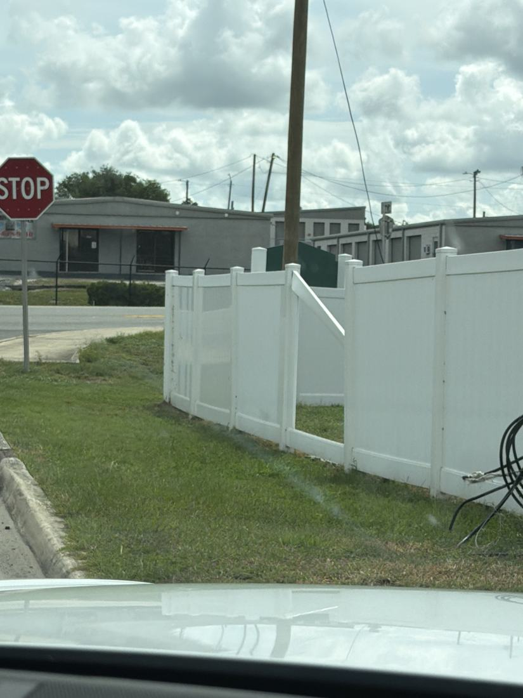

#### Site Ops, Staffing & Equipment

- Roughest community by far, need real plan `OPEN DECISION`

### Nalls Court (NALLS)

Location not in regional map | Unit count not on file | Single Asset | RM AG (Ashlyne Godinez) | 3 items

#### Capital & Infrastructure

- Fence the second drainfield

#### Resident Issues & Enforcement

- Parking violations

- Truck needs to pay to park

  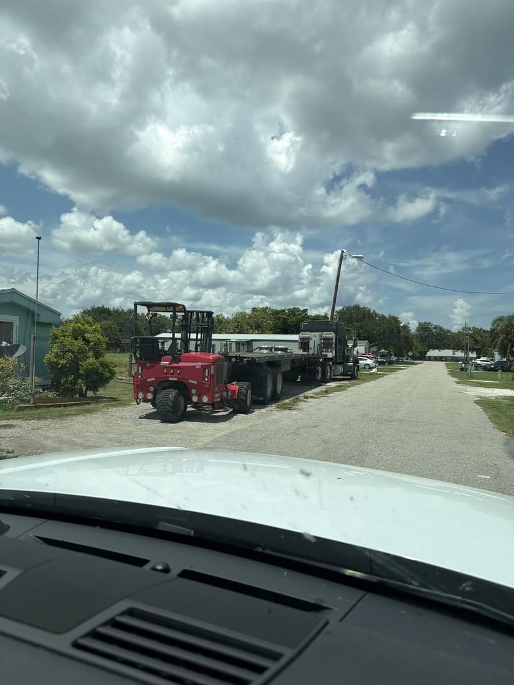

### Paradise Lakes (PL)

Deltona, FL | 200 units | JREF I | RM AG (Ashlyne Godinez) | 11 items

#### Capital & Infrastructure

> No further excavation until utility locating and mapping are complete and verified. John referenced a roughly $30,000 locating and mapping item as a prerequisite. Older water, power and sewer lines are uncertain and crews cannot keep digging without accurate information. `SAFETY`

> A newly installed pole near the road cannot be moved back until Spectrum removes the existing pole and wires, and Spectrum's timeline is unknown. Concern about vehicles hitting it; a barrier or warning structure was discussed. A second problematic pole has been an issue for two years. `SAFETY` `OPEN DECISION`

> Residents are exiting through a broken gate to shortcut to the dumpster, which at night risks hitting nearby obstacles. Temporary options discussed were plastic corner markers, vinyl barriers, metal posts with rope, four-by-fours with rope, and concrete; plastic markers or similar warning barriers are the most economical immediate fix. Replace caution tape with orange construction fencing. `SAFETY`

> The existing gate is damaged, including lightning damage, and the system is too old. A more sophisticated system with individual codes, easy code changes, and entry/exit tracking is needed and should go into next year's budget. `BUDGET ITEM`

> Electrical and underground utility project is three weeks in. Plan is to lay main sections first then branch into individual blocks and lots, with hand digging where equipment cannot fit between homes. One area was treated as a test run and work should get easier once utilities are located.

> Whether future upgrades should be overhead or underground is unresolved. FPL reportedly prefers underground, but there is concern the benefit may not justify the cost and that it would require road work. Existing power may need upgrades including new transformers. `OPEN DECISION`

> Septic and seawall work need to be added back to the project list.

#### Construction Quality & Vendors

> Equipment problems during the work: a machine tipped over and workers damaged areas while turning equipment. Rubber boot connectors were damaged when pipe sections were pulled out; plan is to dig out the damaged sections, install new pieces and reconnect. Frustration that workers damaged items and did not consistently report it.

> The crew's boss does not speak English and relies on phone translation, which is a safety risk if someone is injured or instructions are misunderstood. Part of the crew is hired through another contractor. `SAFETY` `OPEN DECISION`

#### Infill, Homes & Sales

> Lot one is an eviction with possible demolition and lot recovery. Lots two, three and four were discussed for planning and available space. Some homes need work and are on the rehab list.

#### Curb Appeal & Site Standards

> Sign design is possibly underway and remains an active improvement item, to be finalized alongside the gate system.

### Royal Palm (RP)

Clewiston, FL | 51 units | Harpreet | RM AG (Ashlyne Godinez) | 3 items

#### Infill, Homes & Sales

- Look into occupancy - otherwise looks great

#### Curb Appeal & Site Standards

- NEW SIGN LOOKS GREAT `WIN`

- need mailbox shelter

### Vantage Oaks (VO)

Okeechobee, FL | 253 units | JREF I | RM AG (Ashlyne Godinez) | 16 items

#### Capital & Infrastructure

> Paving, curbs and driveways were rebid successfully: cost came down to $683,000 from an $1,800,000 quote. Written estimates to be reviewed on receipt. `WIN`

> Flood zone concern at the back of the site is resolved: flood elevation is 20 feet, and ground grade of 16-17 feet plus the standard set height of 3.8 feet yields roughly 20.8 feet, so no elevation is required.

> Electrical readiness is the critical path to occupancy. Inspector Kevin requires any 200-amp home to have a matching 200-amp pedestal and will not deviate. At Southgate, with 100-amp pedestals, the team avoided upgrades by placing the AC disconnect outside the garage, but that workaround is not acceptable in all jurisdictions. Risk flagged of homes set, surveyed and trimmed with no electric meters available. `OPEN DECISION`

> Large generators to power full 200-amp homes are not viable while the homes are commercially owned: adding connection points would change the wiring diagram and require permits that will not be granted. A full generator solution runs roughly $12,000 for a 3-phase unit plus connection points and stays prohibited for this phase. For open houses the plan is small portable generators for a couple of fans, windows open, purely for showing comfort until permanent power is connected.

#### Construction Quality & Vendors

> Permitting is jurisdiction-specific and inspector standards are inconsistent. In Polk County, fence replacement on commercial property can require permitting and reviews vary by zoning clerk. Okeechobee Building Department is stringent and paper-based: every permit packet needs two copies of the home's installation manual, and permits must be paid for and physically collected within 72 hours of issuance or they cancel, so the team will collect them in person. Permit processing is running three weeks behind, though all permits for current work are filed. `OPEN DECISION`

> Inspections caused significant rework: one inspector approved a pre-pour with a 12-inch pipe matching the street standard, and a later inspector required a 15-inch pipe and a specific concrete slope, forcing demolition, a re-pour and added sod on the slopes. Six-week delay.

> Expediters declined mobile home permitting as too small and complex against large commercial work, so the approach stays relationship-driven with weekly calls to building officials such as Gage and Kevin.

> Sidewalks planned at three feet wide, grassed, routed from the parking pad to the base of the home steps; installation proceeds after CO issuance. Notify Amanda of walkway scheduling once COs are physically in hand.

> Each staged home is stocked with spare touch-up paint, dryer vent parts and warranty booklets consolidated in a kitchen drawer. Residents are advised to live in the home ninety days before completing the homeowner warranty punch list so issues surface through daily use. Chipped Skyline kitchen drawer fronts to be replaced under warranty.

#### Infill, Homes & Sales

> Staging strategy: the company owns all homes on certain streets, so inventory can be staged without resident interference. Decision is to stage one home on every street to show options across floorplans, and to sell from outside units already set, offering four different plans while internal access is limited in some doubles.

> Aggressive on-site marketing with fifty For Sale signs and twenty flags, plus flyer flags at end lots, negotiated with residents via $100 Amazon gift card offers where lots are not company-owned. Direct resident engagement and street-end visibility worked in prior communities.

> Siding package program proposed: bulk purchasing with credits on home purchases to help owners upgrade older units and improve appearance.

> Removing dilapidated and vacant lots has improved community sentiment, and two drug houses were previously removed. `WIN`

> Management is preparing for throughput of twenty new home sales per month; the back office must scale for closings, titles and paperwork alongside a pipeline of roughly 500 used-stock sales to be worked down over time. `OPEN DECISION`

#### Amenities & Common Areas

> Clubhouse plan is a community hub: a covered concrete pad at one end for barbecue and picnic tables, and a closed room with a sink at the other as a small kitchen. Roof was recently replaced. Traditional stove and oven equipment would trigger commercial hood and fire suppression requirements because the space is commercially classified, gas is not allowed at the facility, and a 220-volt upgrade for kitchen equipment is not feasible.

> Kitchen and stove outlet issue to be resolved with Chris in the near term.

### Whispering Pines FL (WPMH)

Titusville, FL | 202 units | JREF I | RM AG (Ashlyne Godinez) | 6 items

#### Capital & Infrastructure

> Significant electrical upgrades needed across the community. Installing new homes may require upgrading the main service, a larger cost than pedestal upgrades, and the electrical company reportedly requires a full community upgrade moving all services underground to meet current code. This affects roughly 64 of 100 sites with substantial added cost per site. Whether the utility should bear some of the code-change cost was raised. Stub electrical to potential future needs such as near the dock. No budget or timeline established. `BUDGET ITEM` `OPEN DECISION`

#### Construction Quality & Vendors

> Permitting for the park work at the bamboo property is still pending with no clear timeline. `OPEN DECISION`

#### Infill, Homes & Sales

> Camp Spot short-term bookings are tying up long-term lots: small units are being booked onto large 50-amp lots, blocking long-term rentals, and the system currently will not book long-term residents past 2026. Proposed fix is minimum stay requirements on certain lots during the season. `OPEN DECISION`

> Minimum stay strategy: start at a six-month minimum with flexibility down to three months if bookings are slow, blocking lots historically used for full-season rentals and keeping others open for short-term. The smaller west side lots may suit short-term better. Alex to help map and block the lots. Final duration and lot list not decided. `OPEN DECISION`

> High activity and interest in two homes on Daisy Bear. Daisy Lane home rehab: finish the kitchen, clean carpets, repair the vanity. Perry Winkle home, post-eviction, has electrical issues and needs work. 366 Lily Mora rental needs new vinyl flooring and appliances.

#### Curb Appeal & Site Standards

> New street signs in progress; Fernando also to check graveling.

## LS: Liz Santiago

13 communities.

### Auburn Ridge (ARD)

Auburn, GA | 160 units (128 MH lots + duplex apartments) | JREF II | RM LS (Liz Santiago) | 12 items

#### Capital & Infrastructure

> Roads are in good condition; roughly three remaining speed bumps need paint.

> A significant share of spend goes to buying water from the City of Auburn; restoring the property well was considered and rejected as too burdensome given treatment, testing and licensing requirements. `BUDGET ITEM`

> 128 MH lots are metered as follows: lots 1-58 sub-metered with Metron meters; the balance on city meters at roughly $5,000 each. Water pipes are buried 5-6 feet deep, making leak detection difficult. Proposal to install a Metron meter downstream of the main city meter to catch supply-line leaks: cost and feasibility not yet assessed. `OPEN DECISION`

#### Curb Appeal & Site Standards

- Mailbox and move to front / add picnic table

> Follow up on an entrance sign near lots 6 and 114.

#### Amenities & Common Areas

- Additional bus stop with kids

> Old office structure could be repurposed by removing the concrete and adding a picnic table, or converted to a community library. No decision made. `OPEN DECISION`

#### Resident Issues & Enforcement

> Path Kids Club, a nonprofit renting a home on the property, runs homework nights and children's programs. Police report a significant reduction in crime since new ownership and the club's arrival. A $500 gift card was provided toward flooring replacement. `WIN`

> Further donation to Path Kids Club for new flooring was agreed in principle; amount and mechanism not specified. `OPEN DECISION`

#### Site Ops, Staffing & Equipment

- Golf cart

> Interviewed a maintenance candidate who appears more willing to handle the physical demands than prior candidates.

> Utility golf cart needed to cover the property; a model with a folding back seat was suggested.

### Brunswick Estates (BRUN)

Brunswick, GA | 65 units | JREF II | RM LS (Liz Santiago) | 9 items

#### Capital & Infrastructure

- Lift station vinyl fence

- Additional speed bumps `SAFETY`

#### Curb Appeal & Site Standards

- Signs for main road and entrance

- Three rail fence to protect soccer field

- Skirting at the green house up front

#### Amenities & Common Areas

- Bleachers for the field

- Look into redoing the grass on soccer field

- Park benches along the marsh

#### Site Ops, Staffing & Equipment

- Trash cans for people by soccer field

### Druid Oaks (DO)

Brunswick, GA | 127 units | JREF II | RM LS (Liz Santiago) | 6 items

#### Capital & Infrastructure

> Ditch cleaning at Druid is complete. `WIN`

#### Curb Appeal & Site Standards

- Lights and camera on the mailbox structure `SAFETY`

- Tree work throughout now

> Second new sign agreed for the back of the property, to match the new one at the front.

> New mailboxes have been broken into multiple times; a motion-activated solar camera with a light was suggested. `SAFETY`

#### Resident Issues & Enforcement

- Notice to residents on sewer work

### Fox Creek (FOX)

Fountain Inn, SC | 129 units | JREF II | RM LS (Liz Santiago) | 19 items

#### Capital & Infrastructure

- Curbs are an issue

#### Infill, Homes & Sales

- Rehab crew to help with soft spots and AC, larger repair projects to take some weight off maintenance to catch them up

> Many legacy residents cannot get approved to buy due to credit. To meet buyer demand and price points, as-is home sales are being prioritized over expensive remodels. New homeowners are told clearly that exterior upkeep (roof coating, pressure washing, skirting) is theirs while interiors are their own choice.

> Frequent and costly floor and air conditioner repairs continue in existing rental homes.

#### Curb Appeal & Site Standards

- Mailbox legs needed in budget `BUDGET ITEM`

- Lot # signs from elements

> Mailboxes themselves are adequate but the support legs and bases are visibly rusted and rotting. Peeling mailbox signage to be replaced and a bulletin board added for community notices.

> Three-rail fencing along the corner to frame the entrance, positioned to avoid tree removal and preserve county access to water utilities.

> New professional unit number markers agreed as a finishing touch for directional guidance and appearance.

#### Amenities & Common Areas

- Bus stop enclosure with better seating for everyone

> Bus stop upgrade to a covered gazebo-style structure with integrated seating, to shelter children and discourage loitering under the mailbox overhang, which shows wear from children picking at it.

#### Resident Issues & Enforcement

> Stricter screening with credit and background checks has helped remove troublemakers and improve the tenant base.

> Team is transparent with applicants about annual lot rent increases, framing them as standard practice in the South Carolina market.

#### Site Ops, Staffing & Equipment

- Leslie has been amazing `WIN`

- Need new pics of the community

- CRM visibility - can’t see joiners notes

- Stephanie not doing the calls thru Rentmanager yet - IT needs to help

> New mowing crew cleared severe overgrowth within two days after the previous contractor failed to perform basic weed eating. A new maintenance worker is described as night-and-day better than former staff who falsified work orders and performed unauthorized tasks. `WIN`

> Photographer to return to capture updated pictures of the property.

### Great Oak RV (GO)

Kissimmee, FL | 231 units | JREF II | RM LS (Liz Santiago) | 9 items

#### Capital & Infrastructure

> Community is on a boil water notice with the aerator pump out; the system was described as wide open. Status of the vendor's return is unclear. `SAFETY` `OPEN DECISION`

> Power cannot be brought to the intended area without rerouting electrical, which requires upgrades. No plan, budget or owner defined. `OPEN DECISION`

> Lift station to be walked and inspected.

#### Construction Quality & Vendors

> Past plan was porch-to-porch alignment rather than porch-to-rear; porches on the main street should face out. Flipping banks as they are replaced was suggested. `OPEN DECISION`

#### Curb Appeal & Site Standards

> Bulletin board outside the office to be replaced and moved to the mailbox units, possibly mounted on the side like a wall, keeping mail carrier access clear and not blocking the community room entrance.

#### Amenities & Common Areas

> Clubhouse interior: grey oak vinyl tile proposed for the floor, drop ceiling noted, lamp post to be replaced. Purple was disliked and the pool area color considered the worst.

> One party considers the current grill/hibachi setup a fire hazard and wants it removed. Proposal to redo the bocce area and relocate the grill nearby, keeping propane unless a gas line is available (a plumber would be needed to connect). A metal roof over the area was raised. No decision or timeline. `SAFETY` `OPEN DECISION`

> A solar light turns on but never off because the sun does not reach it; residents ignore it. Evaluate placement or replace.

#### Site Ops, Staffing & Equipment

> Storage area described as wide open, a potential security concern. One participant did not see it open; needs verification and mitigation. `SAFETY` `OPEN DECISION`

### Greene Pointe (GPT)

Summerville, SC | 95 units | JREF II | RM LS (Liz Santiago) | 1 items

#### Capital & Infrastructure

- Get rid of the chain fences, redo roads and put in curbs

### Hershey Park (HP)

Summerville, SC | 76 units | JREF II | RM LS (Liz Santiago) | 7 items

#### Capital & Infrastructure

- Cracked curbs throughout - vendor fix

  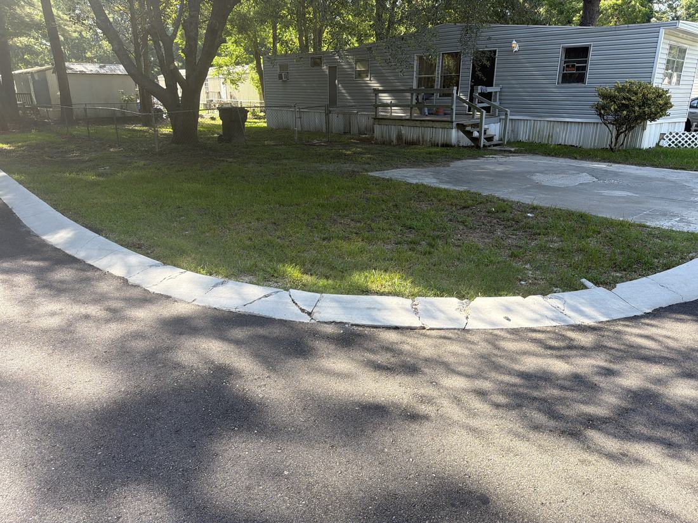

- Fix county electrical box `SAFETY`

  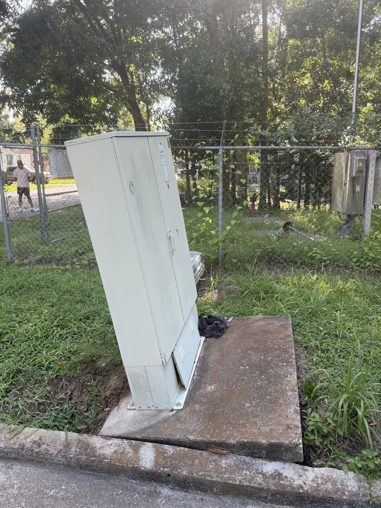

- Look into French drains in the areas that pond

  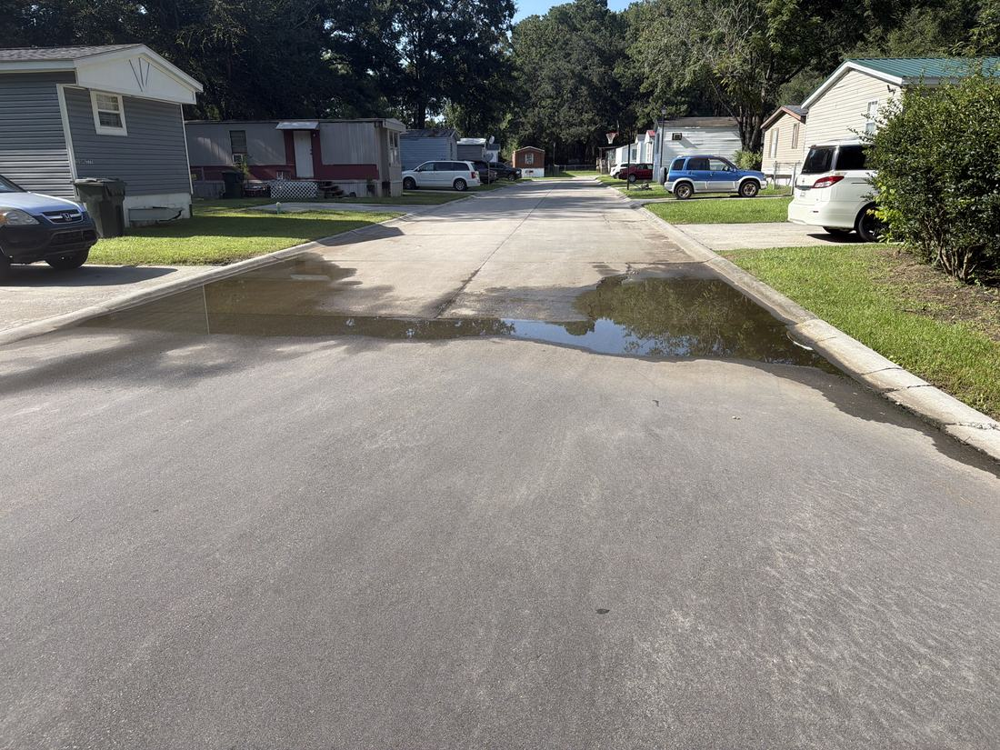

#### Infill, Homes & Sales

- Vacant lot 123

  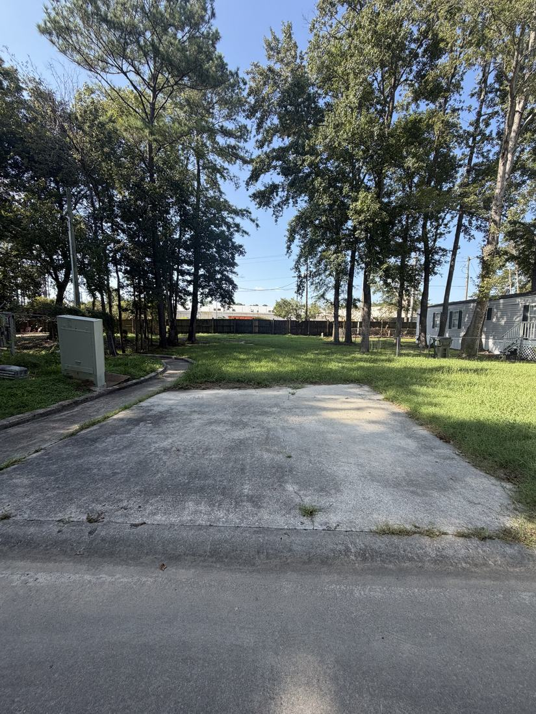

- Front parcel sale 800-900k interested buyer `OPEN DECISION`

#### Curb Appeal & Site Standards

- Right side fence - ask the sellers if they would split `OPEN DECISION`

  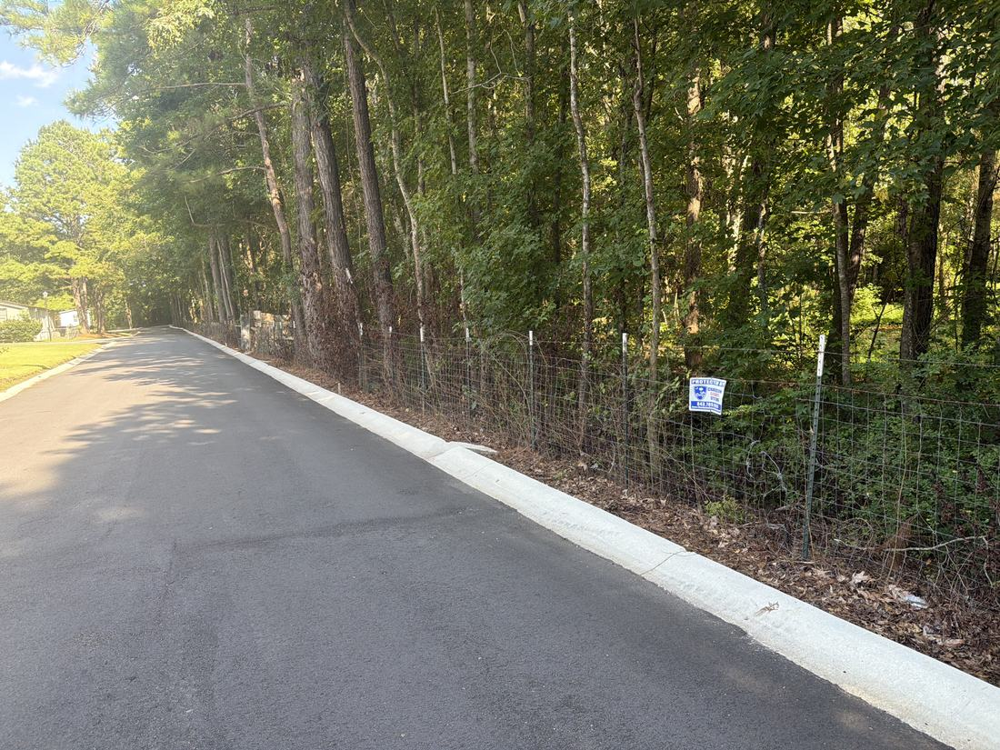

- New mailbox structure looks great `WIN`

### Lucky Clover (LUCK)

Melbourne, FL | 128 units | JREF I | RM LS (Liz Santiago) | 10 items

#### Capital & Infrastructure

> New roads and painted speed bumps are a significant improvement; the fresh paving reads as wider roads even though dimensions are unchanged. Disruptive residents moved out during the improvement phase, leaving a more peaceful community. `WIN`

#### Construction Quality & Vendors

> Install workflow runs Champion for the set and Cavco for final trim-out and sealing. Target is 45-60 days from delivery to setup; current average is 37 days. Soft-set procedures of about 15 days are permitted for park models in some jurisdictions such as River Oaks; others require full permitting for all home types.

#### Infill, Homes & Sales

> Old septic systems continue to be abandoned in parallel with other infrastructure work.

> Strategy is to incentivize residents to trade older RVs or mobile homes for new manufactured homes, moving the park from roughly 50% RV occupancy toward 100% home occupancy.

#### Curb Appeal & Site Standards

> Rotting perimeter fence in the common area to be replaced. Flagpole to be upgraded with a larger American flag and a Parakeet flag beneath.

> New glass-enclosed bulletin boards to go behind every mailbox cluster so notices are visible in a secure weatherproof display.

#### Amenities & Common Areas

> Underutilized shuffleboard court to be resurfaced or converted to pickleball. Existing sun shades sag, pool water when it rains and degrade quickly in the Florida climate; a permanent metal roof is the more durable alternative. `OPEN DECISION`

> New lighting planned for the common area, run from an external line tied to the photocell on the dumpster area light so it cycles automatically with the sun.

#### Resident Issues & Enforcement

> Resident notice with a cover letter on the status of engineering and septic work, to establish transparency.

#### Site Ops, Staffing & Equipment

> Three tires to be removed from the storage area.

### McGregor Downs (MCG)

Columbia, SC | 231 units | JREF II | RM LS (Liz Santiago) | 26 items

#### Capital & Infrastructure

- Tie into city water

- Partial repaying in back area where drains are sinking - cut them out `SAFETY`

  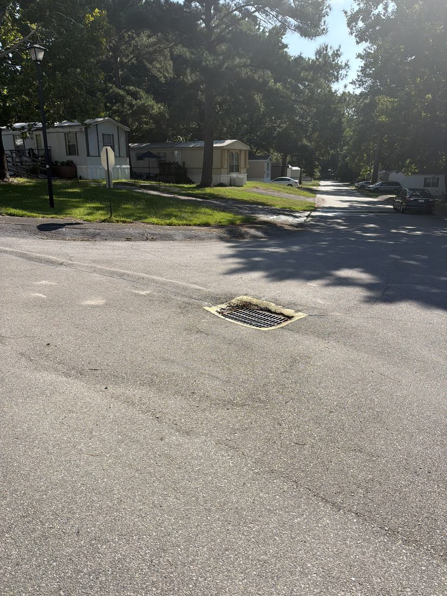

> The recent road project has produced significant flooding and drainage failure, with some storm drains completely plugged. One drain covered with two-by-fours and metal sheathing is an immediate safety risk and needs an assigned owner for mitigation. `SAFETY`

#### Construction Quality & Vendors

> Warranty claim against the paving vendor is being pursued: gather all prior communications, confirm warranty terms (believed still in period), send a firm written response, and obtain quotes from national vendors such as Rose Paving to document scope and cost for the file. Legal action is possible if the vendor is unresponsive. `OPEN DECISION`

#### Infill, Homes & Sales

> A prior sale fell through; securing the title is the next critical step. Pricing discussed in ranges of $1,100 rent versus $30,000 purchase. Strategy is to list and gauge market interest before committing to rehab. The property is deemed real property and the county will be contacted for clarification; ability to sell is tied to completion of herbicide/preventative applications. `OPEN DECISION`

> Many prospective applicants start but never complete applications, often over concerns about their history. Strategy is to contact them proactively before they pay the non-refundable fee.

#### Curb Appeal & Site Standards

- Mailbox enclosure

  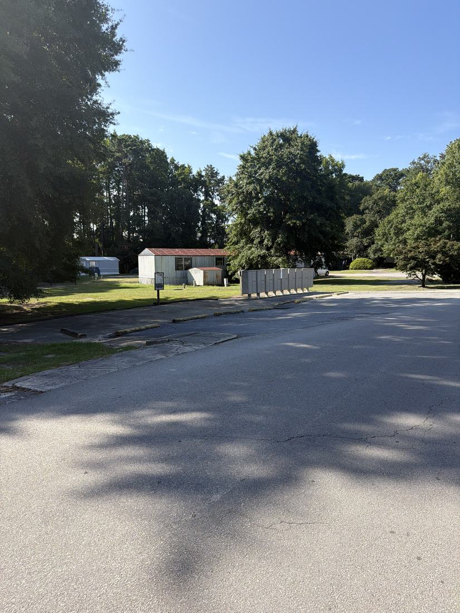

> Budget to renew fencing and remove the unattractive chain link sections. Drainage issue noted where water runs into backyards off a single rolled curb. Mailbox standardization and uniform mini blinds were raised as marketing improvements. `BUDGET ITEM`

#### Amenities & Common Areas

- Community center - rentals for community parties etc `OPEN DECISION`

- Repair the concrete pool deck and do the fencing

- Add playground but there’s a homeless camp behind it. Prostitution and narcotics issues `SAFETY` `OPEN DECISION`

  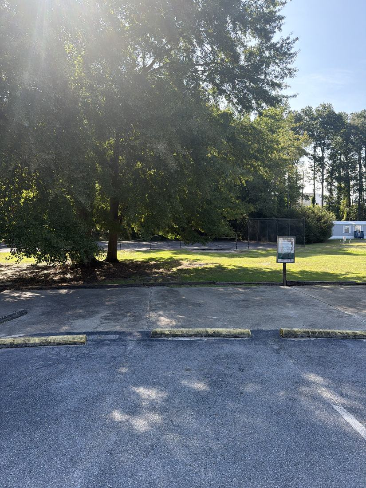

- Fix pool, repair basketball court fence and add hoops

> Pool is currently unmaintained and closed. Three maintenance service estimates (3, 5 and 7 day) are pending a decision. A permit is in hand but the pool cannot open until the surrounding fence is replaced to meet height compliance. Staff adding chlorine was raised, with concerns about training. Responsibility and budget for the fence are unassigned. `OPEN DECISION`

> Pool/pond has multiple patches, was recently drained, cleaned and refilled but is deteriorating again. Staff certification for water management and grinding and sealing the concrete deck were both suggested.

> Lawn area is used for kids' soccer and dog walking; a small playground or park area was suggested, and a dog park was raised and set aside. Renting the clubhouse for private events would need a rental and deposit model with defined access control and a decision on pool access. No decisions made. `OPEN DECISION`

#### Resident Issues & Enforcement

- Cameras in office and in front of office too. Also by dumpsters `SAFETY`

- Access to cameras via app

- Follow up on the title issue with sellers manager `OPEN DECISION`

> Residents report the prior manager registered home titles in her own name, which is preventing them from obtaining insurance. The team believes the seller must resolve it and is working to identify the right contact. Owner for driving this to completion is undefined. `OPEN DECISION`

> Security incidents include children breaking into houses, a car theft, and theft of signs and flowers. A new doorbell camera at the office has reduced aggressive entries. More cameras recommended inside and outside the office, around the park, and at the clubhouse. Locations, equipment standards, retention policy and budget are undefined. `SAFETY` `OPEN DECISION`

> A back-to-school event with hot dogs and backpacks was held.

#### Site Ops, Staffing & Equipment

- Pool maintenance - training course for Marcus so he can maintain

- Look into separate cans garbage for residents

> Bulk items are blocking dumpsters and preventing haulers from reaching the bins. The team supports moving to individual cans with a chargeback system, plus escalating fines of $75 then $150 for illegal dumping. Vendor selection, distribution, billing, enforcement and resident communication are all undefined. `SAFETY`

> A maintenance shed containing a zero-turn mower and other equipment was discovered; contents to be inventoried.

> Physical archives (maps, photos, water system documents) to be shipped to the office for scanning and digital backup.

### Oakside (OAK)

Summerville, SC | 93 units | JREF II | RM LS (Liz Santiago) | 4 items

#### Capital & Infrastructure

- County and state road needs paving `OPEN DECISION`

  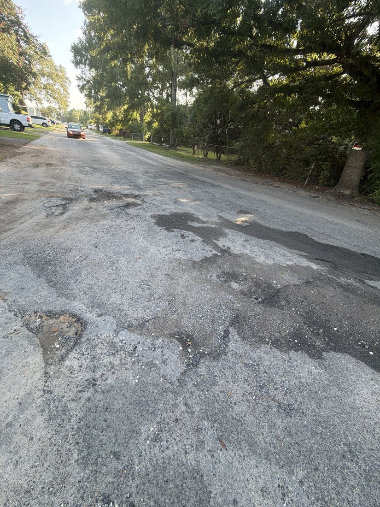

#### Curb Appeal & Site Standards

- Sign looks great `WIN`

- Three rail fence up front

  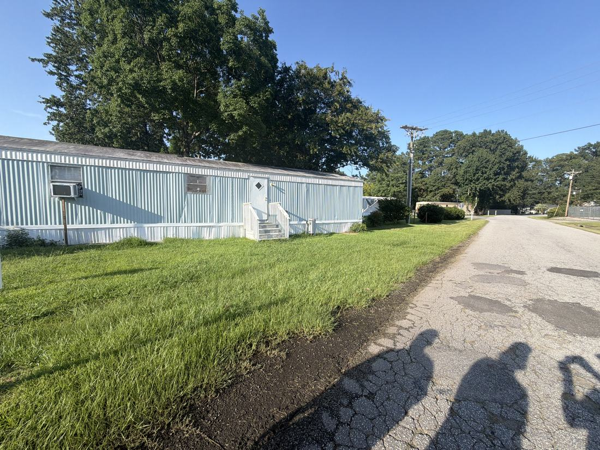

- Mailbox enclosure

  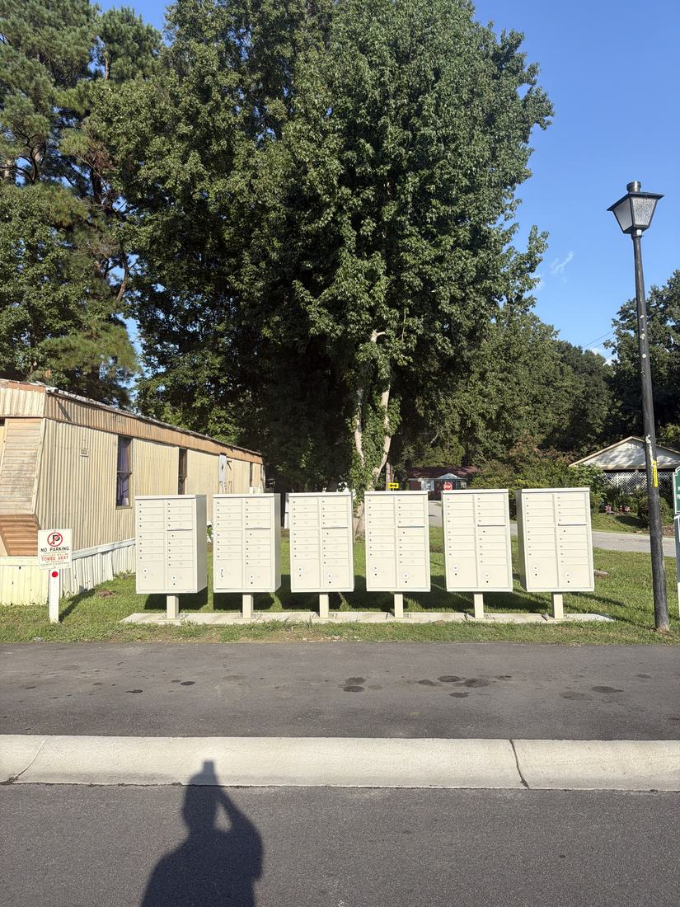

### Parkwood (PARK)

Columbia, SC | 90 units | JREF II | RM LS (Liz Santiago) | 6 items

#### Capital & Infrastructure

- Clear out the ditch line

  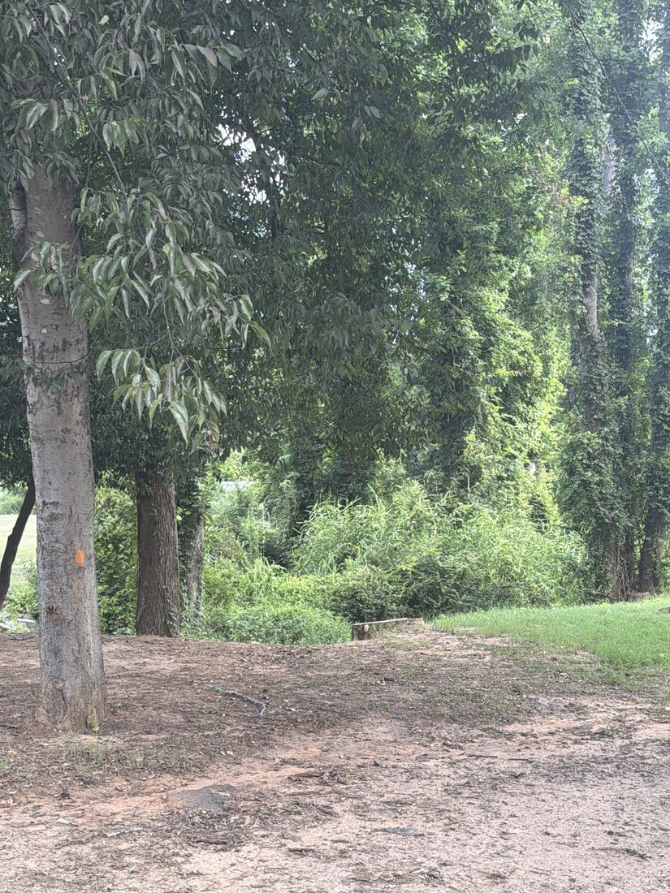

#### Infill, Homes & Sales

- Lot 45 and the other “real property” homes, get flipped so we can sell

#### Curb Appeal & Site Standards

- New mailbox structures

  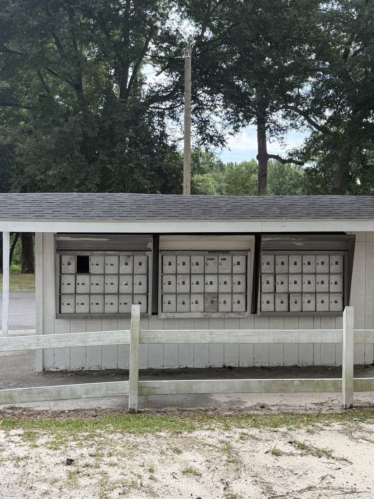

- White fencing improvements throughout

  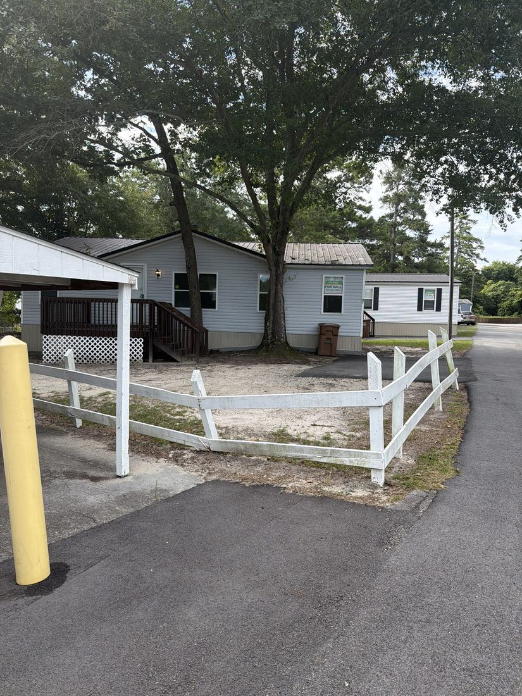

#### Amenities & Common Areas

- Amenity - either playground, grills or pavilion `OPEN DECISION`

  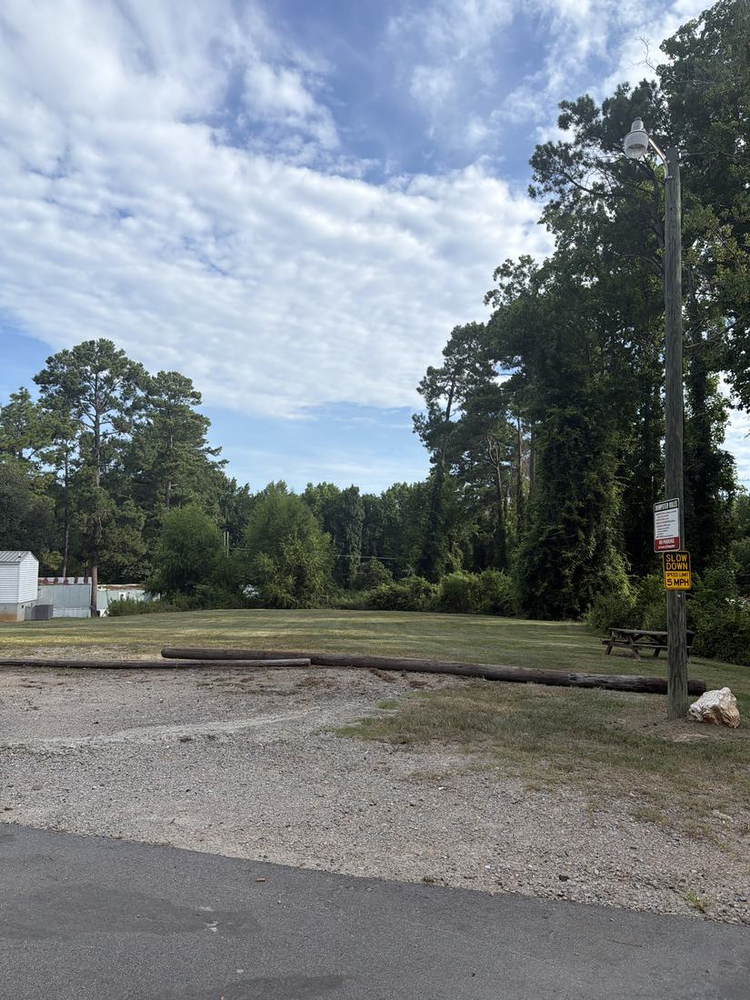

#### Site Ops, Staffing & Equipment

- Better without dumpsters but now people dump at MCG

### Regency I & II (REG)

Savannah, GA | 424 units | JREF II | RM LS (Liz Santiago) | 25 items

#### Capital & Infrastructure

> Regency I: roads on Green Oak need work; seal coating, patching, or repaving sections were all discussed.

> Regency I: sinkholes reported forming near a speed bump and in the middle of a road. No inspection or repair assigned. `SAFETY` `OPEN DECISION`

> Regency II: the county's right-of-way for ditch access complicates clearing. A storage shed on the property has no power because the county would not permit it.

#### Construction Quality & Vendors

> Regency II: sideways doubles on two blocks need enforcement to be properly tied down. `SAFETY`

#### Infill, Homes & Sales

- **Regency I:** Convert bulk storage area to rental trailer and rv storage

  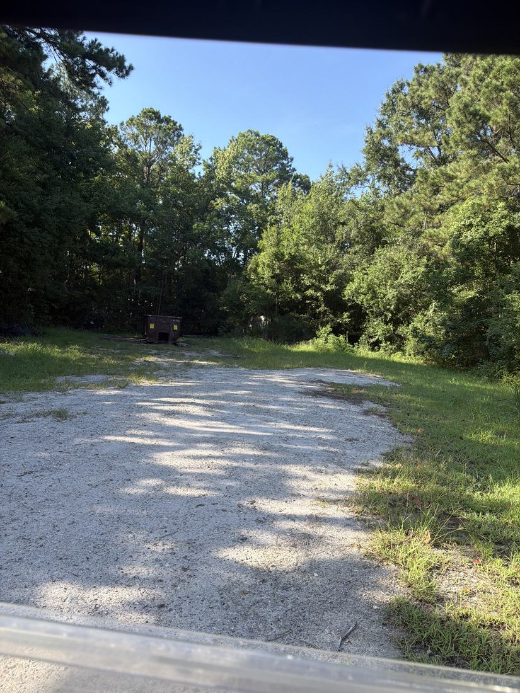

> Regency I: roughly 14-25 vacant lots exist, but many are too small or would require relocating existing homes. Fill plan unclear. `OPEN DECISION`

#### Curb Appeal & Site Standards

- **Regency I:** New mailboxes and structures

  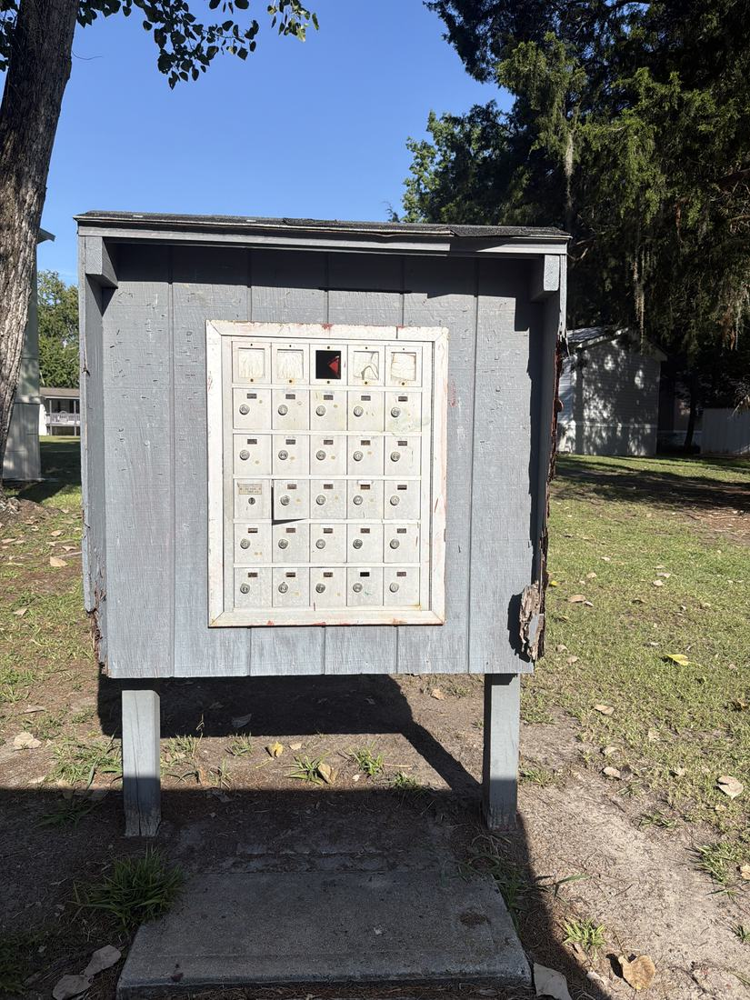

  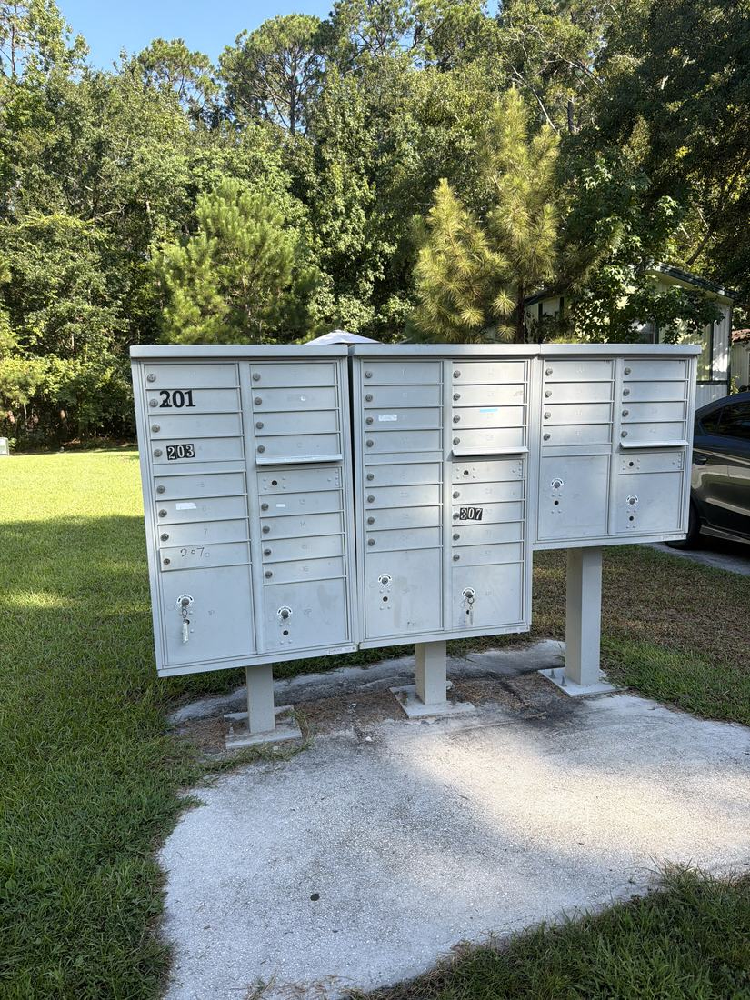

> Regency I: new sign has been delivered and is in the shop awaiting installation. Plan is a white pole with decorative elements added later. Placement in front of the electrical pole is complicated by a city easement on that land.

> Regency I: tree trimming needed, ideally before hurricane season, for both appearance and safety.

> Regency I: existing mailboxes are old and falling apart. Replacement was already approved and a vendor is being sourced; new structures will be larger with better weather protection. Green Oak's units are newer metal.

#### Amenities & Common Areas

- **Regency I:** New pool furniture

- **Regency I:** Gazebo / sitting area at island up front

- **Regency Ii:** Covered structure and better picnic area

  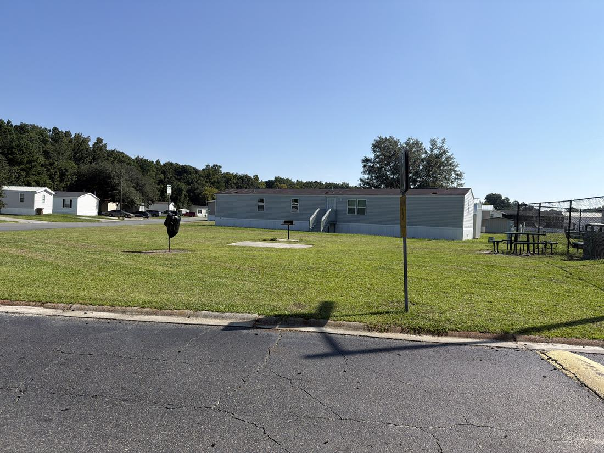

> Regency I: one bathroom needs to be brought into ADA compliance.

#### Resident Issues & Enforcement

- **Regency Ii:** Lots of parks charge for double lots. Good to charge landlords `OPEN DECISION`

> Regency I: over 10 landlords in the park, possibly 20-30. Engaged landlords keep better properties. One landlord holding close to 20 units and charging up to $2,000 rent was identified as a significant problem. No long-term strategy set. `OPEN DECISION`

> Regency I: property is materially cleaner since takeover, and fines for violations are now enforceable, which is motivating residents to clean up their lots. The inspector acknowledged the ongoing licensing process, so operations continue without issue.

> Regency II: road access rules had to be strictly enforced after the park was fined when an ambulance could not get through.

> Regency II: no standard resident lawn-care schedule, producing violations and uneven appearance. A set mowing day was suggested. `OPEN DECISION`

> Regency II: residents have planted bushes and other items on land that is not theirs, including along the county's ditch access, and resist removal. `OPEN DECISION`

#### Site Ops, Staffing & Equipment

- **Regency I:** New golf cart

> Regency I: dumpster area is a persistent problem with tire and bulk dumping, at $395 per month. Plan is to remove the dumpster, clear the container of tires, and convert the space to trailer storage.

> Regency II: outgoing maintenance team recommends a zero-turn mower so one person can cover the whole park, plus a weekly weed-spray schedule. Rubber-mulch areas are hard to maintain and attract cats.

> Regency II: a small excavator was identified as the critical long-term purchase, turning ditch and overgrowth clearing into short jobs instead of rentals or outside contractors. The Nissan truck is not adequate for hauling. `BUDGET ITEM`

> Regency II: outgoing maintenance staff argue for providing on-site housing for maintenance, on the view that a resident employee holds the grounds to a higher standard. `OPEN DECISION`

### Shady Acres (SA)

Brunswick, GA | 219 units | JREF II | RM LS (Liz Santiago) | 24 items

#### Capital & Infrastructure

- Do the roads after the water and sewer

> Phased sequencing agreed: lot prep, tree work and clearing first, roads last, because heavy equipment for new homes would damage new pavement.

> Road condition is mixed and some roads may be city-owned; an engineering study will clarify. Widening one turn was discussed to stop corner-cutting, and speed bumps were raised. `OPEN DECISION`

> A collapsed pipe is being handled by John. A vinyl privacy fence is needed at the lift station for safety and appearance. Who receives the lift station alarm was raised and not settled.

> Power company can install new streetlights but the existing system is old; replace-vs-add was not decided. Streetlights on the left side to be replaced. `OPEN DECISION`

> Active EPD violation on the community pond: a broken cement wall is causing seepage, reportedly damaged by the previous company. Pond also needs overgrowth cut back and duckweed treated. Two alligators reported in the pond. No repair plan, timeline or owner assigned. `SAFETY` `OPEN DECISION`

#### Infill, Homes & Sales

> Vacant homes concentrated on Front Street and State Street are former rentals in poor condition. A renovated 3-bed 3-bath at lot 21 rented for $1,850. A new rehab team starts within days.

> Significant land available for new units, clearing estimated at roughly $15,000 per acre. Georgia noted as a relatively easy state for expansion. Scope, cost and timeline not finalized. `OPEN DECISION`

#### Curb Appeal & Site Standards

- Single mailboxes everywhere

> Substantial tree and overgrowth work needed. Pine trees are the main problem: falling needles and shallow roots that topple in storms. Specific trees whose roots are lifting homes were identified for removal.

> White three-rail PVC fence reinforced with steel beams planned at every turn to keep vehicles off the grass.

> Mailboxes are inconsistent across the community. Plan proposed to standardize on uniform white PVC single mailboxes with reflective numbering, pending post office consultation. `OPEN DECISION`

#### Amenities & Common Areas

- Gazebo with bus stop up front and playground and picnic tables

- Bus stop by office

- Basketball court

- Playground

> Amenity proposals: benches and picnic tables in grassy areas, a playground to keep children out of residents' yards, a bus stop shelter at the front possibly combined with the playground, and bleachers in shade. The fenced former pool area was identified as a candidate site for a basketball court and playground. None finalized. `OPEN DECISION`

#### Resident Issues & Enforcement

- Buy sheds in bulk for residents for them to store their construction materials in `OPEN DECISION`

> Resident memo to go out by email and in print explaining ongoing work and project delays. Trees and roads are the most common complaints across properties.

> Unpermitted structures and additions are a significant issue; dollar violations are being used and are reportedly working.

> Offering sheds to residents to store construction materials, bought outright, financed monthly, or rented. Not decided. `OPEN DECISION`

#### Site Ops, Staffing & Equipment

- Golf cart and AC gator

> Fifth attempt to hire for the maintenance position; prior hires did not want to work outdoors. Proper equipment such as a Gator was suggested to improve retention. Get pricing.

> To stop trash cans being knocked over, building containers possibly from pallets was discussed; large hard-to-move metal bins were ruled out. No decision. `OPEN DECISION`

## AP: Alex Pontes

11 communities.

### Belle Haven (BELL)

Clearwater, FL | 93 units | JREF I | RM AP (Alex Pontes) | 16 items

#### Capital & Infrastructure

- Streetlights

> An entire back section of homes is on a single master meter. Streetlights are functional but provide inadequate lighting.

#### Construction Quality & Vendors

> Some units were extra messy at turnover, and certain doors lack the structural provision for top deadbolts, which is both a security and a repair problem.

#### Infill, Homes & Sales

- No reason we shouldn’t be able to pound Facebook on monthly RV residents

- Do the roofs on the rentals

> Custom windows run roughly $13,000 per house with a six-week lead time. A workable fix using standard replacements has been found for some broken windows, though it is not ideal. The on-site manager sourced an abundance of windows to avoid the custom order process, found all needed mini blinds in the property sheds, and bought shower curtains to improve unit presentation.

> Contractor roof patching is proving insufficient. Team agreed to move to full roof replacements at an estimated $5,000-$7,000 per roof rather than continue temporary fixes, starting with the occupied unit that currently needs patching.

> Affordability gap is the primary occupancy hurdle: strong interest, but many prospects are lower-income or students who cannot afford the homes. The park ran about fifty sales per month when first purchased. The team was surprised it could not secure eight long-term RV tenants from the large local contractor pool. `OPEN DECISION`

> To fill vacant lots and hold revenue while awaiting new home deliveries, target long-term RV tenants with a block-and-blast Facebook campaign, with a view to upselling to park models later. Buy, skirt and list one RV for sale to test the market.

#### Curb Appeal & Site Standards

- New mailboxes throughout

- Repaint the screened in areas

> Install new fencing, signage, and flyer flags of the type used successfully at Fox Creek to improve visibility and curb appeal.

#### Amenities & Common Areas

- Clubhouse extended grill area over shuffleboard

> Add a pickleball court on the existing basketball court and a dog park in the field. Covered grill area agreed as a communal space.

#### Resident Issues & Enforcement

> A resident raised a persistent water leak inside her trailer, arguing that because the park is on a single master meter the owner is responsible. Management disputed this, noting the home was purchased as is. Site visit to investigate the meter and pipe scheduled for Monday.

#### Site Ops, Staffing & Equipment

> Office area has no designated parking, so staff park near the office van, and the clubhouse grill area is temporarily being used for parking. Major work such as road repaving follows finalization of city plans and new home installs.

### Crystal Acres (CA)

Crystal River, FL | 51 units | Kippy | RM AP (Alex Pontes) | 2 items

#### Site Ops, Staffing & Equipment

- landscaper is awful. Maintenance said if he has a mower and trailer he could do it
  - Logged jointly for Crystal Acres and Hunter Springs.

> The primary landscaper covering Crystal Acres and Hunter Springs is underperforming and the on-site maintenance person is redoing his work. Proposal is to buy a zero-turn mower and small trailer so maintenance can take landscaping in-house and cut cost. Including lawn care for all residents as an added service was raised to ensure uniform maintenance, with no decision on inclusion or pricing. `OPEN DECISION`

### Gulf Breeze (GULFPO)

Hudson, FL | 39 units | Origins | RM AP (Alex Pontes) | 9 items

#### Capital & Infrastructure

- Roses water issue - get it fixed `OPEN DECISION`

- Lot 36 and 4 she can’t get her water `OPEN DECISION`

> Several residents who purchased homes cannot get water service activated, including one buyer of four homes. The water company's explanations are unclear and inconsistent, having earlier cited a PVC shortage, and the resident has followed their instructions repeatedly without resolution. The problem hits new buyers; long-term residents have service. Root cause unresolved and no contingency plan if the utility stays uncooperative. `SAFETY` `OPEN DECISION`

#### Construction Quality & Vendors

> A new contact who remodels, repairs roofs and knows an electrician quoted roughly $700 for a roof repair. Obtain a second quote for comparison.

#### Infill, Homes & Sales

- 2 fema homes `OPEN DECISION`

  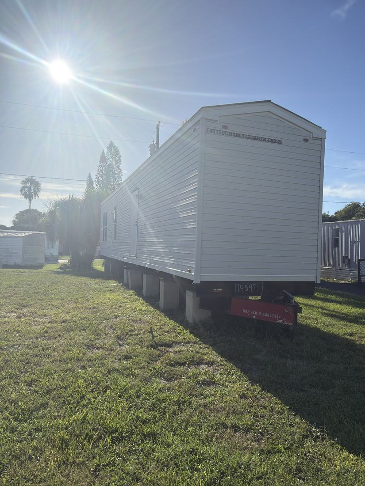

  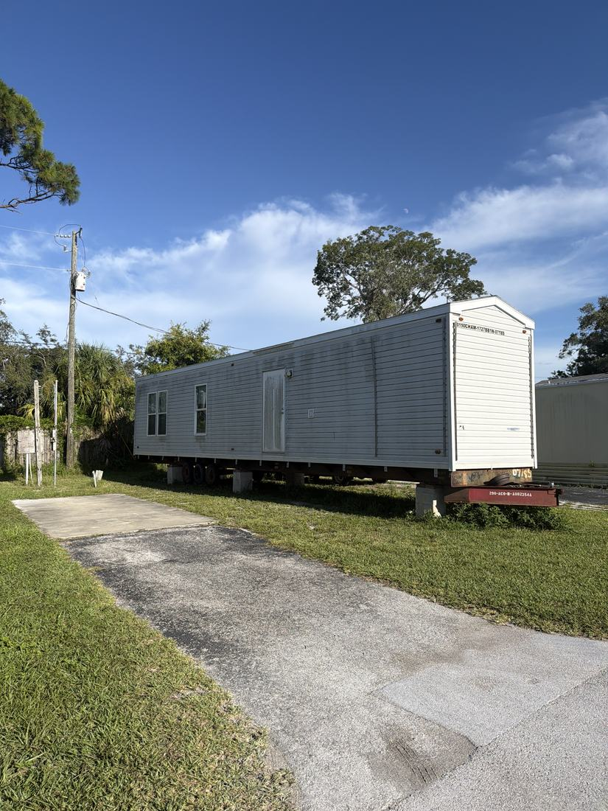

> Multiple vacant sites and homes, including two FEMA homes and several needing work. Legal status and permitting of the set FEMA homes is unknown and must be verified before deciding to scrap, sell as-is, market low, or give away. Some homes hold quality appliances worth salvaging for other rehabs if scrapped. `OPEN DECISION`

> Three newer park models (39, 40, 41) are set but water damaged; plan is a quick remodel or offering them as-is to get them occupied. The home on lot two behind the office is park-owned after an eviction, needs work, and already has an applicant.

#### Resident Issues & Enforcement

> Policy confirmed that all applicants including investors pay the $50 application fee and a deposit, refunded if they pass the background check and purchase. Handling of an investor who wants to rent the property out is unclear under current policy. `OPEN DECISION`

#### Site Ops, Staffing & Equipment

- Have maintenance do mowing of all lots - include for residents going forward

### Hunter Springs (HSRC)

Crystal River, FL | 25 units | Kippy | RM AP (Alex Pontes) | 2 items

#### Site Ops, Staffing & Equipment

- landscaper is awful. Maintenance said if he has a mower and trailer he could do it
  - Logged jointly for Crystal Acres and Hunter Springs.

> The primary landscaper covering Crystal Acres and Hunter Springs is underperforming and the on-site maintenance person is redoing his work. Proposal is to buy a zero-turn mower and small trailer so maintenance can take landscaping in-house and cut cost. Including lawn care for all residents as an added service was raised to ensure uniform maintenance, with no decision on inclusion or pricing. `OPEN DECISION`

### Palm Spring Estate (PSEPO)

Tarpon Springs, FL | 45 units | Origins | RM AP (Alex Pontes) | 3 items

#### Infill, Homes & Sales

> Ugly homes are the main challenge. Options discussed were replacing them with park models, keeping any home that can be replaced, and incentivizing owners of newer homes at other locations to sell so those homes can be moved here. Strategy not finalized. One difficult home was recently approved. `OPEN DECISION`

#### Curb Appeal & Site Standards

> Internal signage is missing or in disarray and reads as random and messy; needs to be redone. No decision or owner assigned. `OPEN DECISION`

> Property is much cleaner than before, particularly behind the office, and a significant amount of demolition has been completed. `WIN`

### Paradise Palms (PP)

Lakeland, FL | 50 units | JREF II | RM AP (Alex Pontes) | 10 items

#### Capital & Infrastructure

- Fence around the new drainfield? `SAFETY` `OPEN DECISION`

#### Construction Quality & Vendors

> Stair and door configuration is inconsistent across identical models, night and day between two crews. Some homes have stairs oriented to match the door swing, others do not, forcing residents to walk around the landing to enter. Fix is either rehanging doors to match the stairs or reorienting the stairs to match the doors, finished with skirting.

> Most concrete pads and steps in the park are correctly and well executed; the outliers show missing caps, exposed wood where skirting was not applied, and misaligned steps. Full park walk-through needed to log every exception with lot numbers and photos into a punch list.

> Standardize and enforce the install spec at install: door swing dictates stair orientation, stair skirting on all visible wood, concrete step alignment to the approach path. Hold a pre-work briefing with both crews.

> Tree roots were badly damaged during electrical trenching. Inspect the affected areas and propose corrective landscaping or root protection.

> Punch items: paint the office front door, replace the missing post cap (ref 1923), and close out all missing caps against the punch list.

#### Curb Appeal & Site Standards

- Mailbox cover

  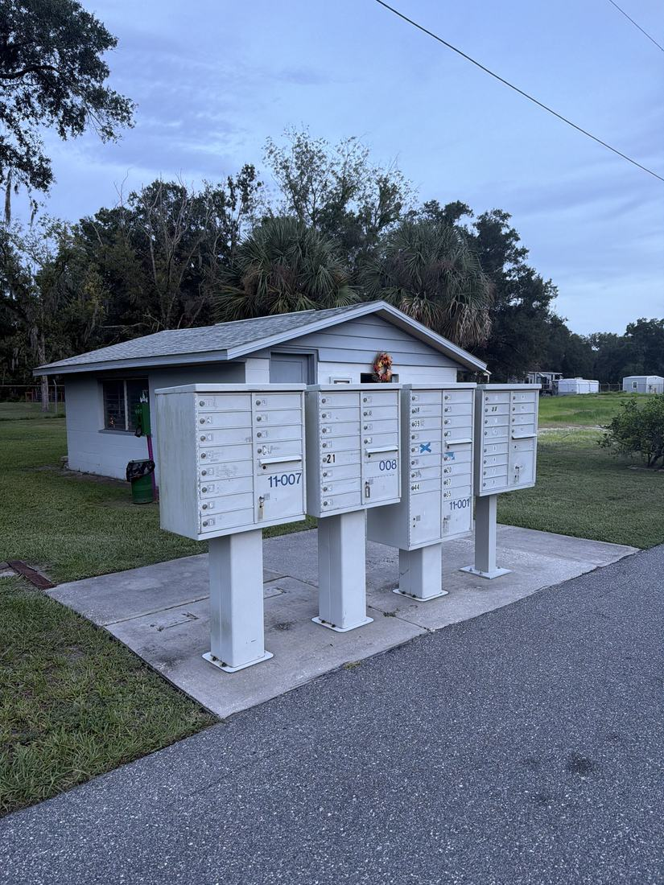

#### Resident Issues & Enforcement

> 55+ community, so quality, safety and appearance carry more weight and visible defects do more reputational damage. Team likes the park layout.

#### Site Ops, Staffing & Equipment

- Curbside trash? `OPEN DECISION`

> Entry codes for the houses and the clubhouse were not working and the team had to follow another vehicle in. Audit and fix the codes, distribute updated ones to authorized personnel, and retire the dead codes. `SAFETY`

### River Oaks (RO)

Ruskin, FL | 113 units | JREF I | RM AP (Alex Pontes) | 30 items

#### Capital & Infrastructure

- Take out the median with trees to make additional parking on both sides. When paving pave driveways and dedicated parking

  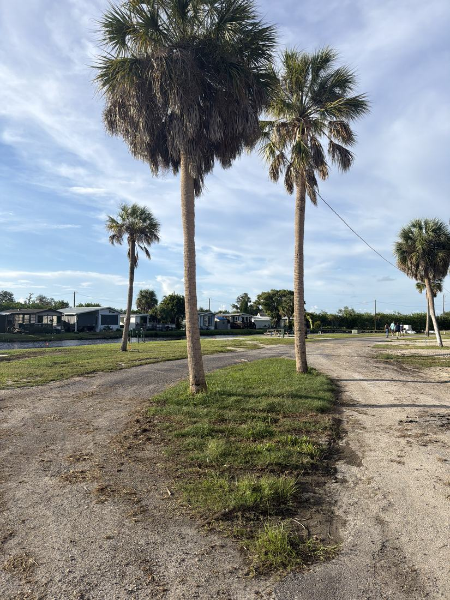

- Seawall around entire lake and boardwalk? `OPEN DECISION`

- Underground plumbing

- Electric to the dock

- Move well somewhere that it can be to not kill the dead lots `OPEN DECISION`

> Power must be restored to the pier; George started the work and it is not complete. Electric to the dock still outstanding.

> Digging a new well to reclaim 6-8 lots was viewed as cost-effective at that yield; it would require relocating the horseshoes area.

> Broader infrastructure (water lines, seawall, roads) to be phased after a defined time frame.

#### Infill, Homes & Sales

- Look into porches for the homes with steps on the front

- Vicki should go to other parks and tell the managers for lower priced homes send them to us

- Billboard ads for River oaks

> Homes are not currently listed in Rent Manager and the process to list and sell through the platform is unresolved, which is blocking sales. `OPEN DECISION`

> Disagreement on inventory management: a hold on bringing in more homes until current homes sell was suggested to build sales momentum. No decision recorded. `OPEN DECISION`

> Offering a 15% discount to current RV residents to convert them to home buyers was proposed; terms and implementation to be defined.

> Grassroots marketing agreed as a strong strategy: Vicki to visit communities with homes priced over $100,000 and ask managers to refer lower-cost buyers to River Oaks for a referral fee; visit RV parks to learn visitor patterns and distribute flyers to snowbirds with a $50,000 budget; target the Elks Lodge and American Legion, frequented by retired veterans living in mobile home parks.

> Billboard advertising to raise visibility for a tucked-away park, starting with the blank board on Bayshore Road at Route 41 in Ruskin. Referral fees to outside managers raised an ethical question with no resolution on managers who cannot accept payment. `OPEN DECISION`

#### Curb Appeal & Site Standards

- Parakeet street signs

#### Amenities & Common Areas

- Bathhouse needs fully redone

- New fish cleaning station

- Swinging trex swing to left of clubhouse

- Fix the bingo machine

- Microwave for the clubhouse

- Pet wash station outside

- Aerator for fountain

> Clubhouse: restroom needs upgrading and an inspection report is to be reviewed. Post-hurricane repairs included a new roof but the building is still leaning and leaking, and no owner was assigned to the structural issues. Needs a microwave, new windows, and possibly wall repairs. `OPEN DECISION`

> Agreed to buy a used bingo machine from the marketplace for cash rather than replace new. Outdoor furniture: wooden swing favored over hammocks on safety grounds, with Adirondack chairs considered.

> Fountain is not working; a quote was received for an aerator, recommended as the better lower-maintenance option, and agreement that it needs to be running.

> Amenity ideas pending a resident survey that has not yet been created or distributed: bocce court, horseshoes, dog wash, car wash, Tesla charging. A pickleball court is not feasible at the suggested location because of an underground electrical transformer. `OPEN DECISION`

#### Resident Issues & Enforcement

- Resident survey - bocce, pickleball, etc

> Residents are actively engaged, decorating for holidays and organizing activities. Outdoor movie nights by the pier using a projector and Bluetooth speakers were suggested, plus Fourth of July and Halloween events.

### Riverwalk (RW)

Gibsonton, FL | 201 units | JREF II | RM AP (Alex Pontes) | 17 items

#### Capital & Infrastructure

- Look at doing the driveways along with roads and curbs

#### Construction Quality & Vendors

> Multiple problems on new home stairs and doors: metal treads on wood, off-center doors, improper door swings, stair concrete not wide enough for the home, and some steps appearing to tip. No owner assigned. Needs a contractor or QA lead to audit and remediate against a punch list. `OPEN DECISION`

> Lock boxes are on some homes but not the two new ones; verify across all homes and install where missing.

> Confirm the status of the window that was supposed to be removed and correct it.

#### Infill, Homes & Sales

- Identify flood zone lots and move RVs around for infill `OPEN DECISION`

> Proposal to give RV owners 1.5 months to move to lots where construction is not permitted. Most RVs are believed to be on trucks-only lots and that needs confirmation, along with which lots can host RVs, before a relocation plan and timeline can be drafted. `OPEN DECISION`

> Hillsborough County home replacement program helps residents replace homes for a cost; the aim is to secure it for this community. No owner or next step assigned. `OPEN DECISION`

#### Curb Appeal & Site Standards

- Is the fence ours? `OPEN DECISION`

- Mailbox covers

- Some of the street signs look crooked

> Matching fencing and a mailbox area improvement, possibly with a covering. The current setup lets carriers deliver without leaving their vehicles.

> New street signs were praised. Brandon from Valdida and Fernando installed them. `WIN`

#### Site Ops, Staffing & Equipment

- Clear out the food

- Cans trash service

> Dumpsters proposed at the end of the street to keep them off the road, with concern that roll-offs would damage the pavement. No final decision. `OPEN DECISION`

> Thorough clear-out of old items needed, and crews should clean up before leaving each day.

> A list of issues covering all lots was sent to John; confirm receipt and track follow-ups.

### Terrace Crossings (TC)

Thonotosassa, FL | 65 units | JREF II | RM AP (Alex Pontes) | 6 items

#### Infill, Homes & Sales

> Some recent sales at Terrace Crossings, with showings improving on online scheduling.

#### Curb Appeal & Site Standards

- Mailbox cover

  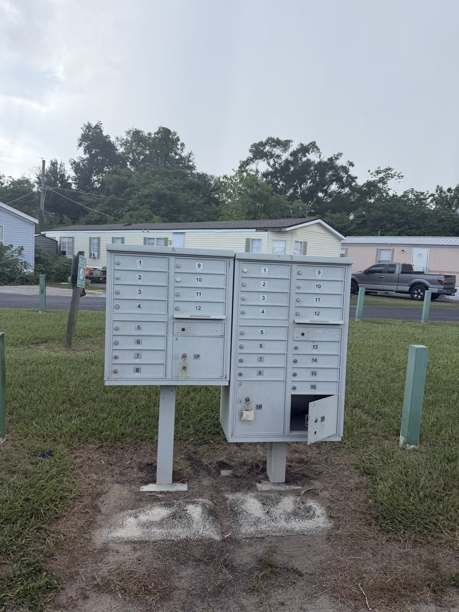

- Paint and straighten the do not park poles on all streets

  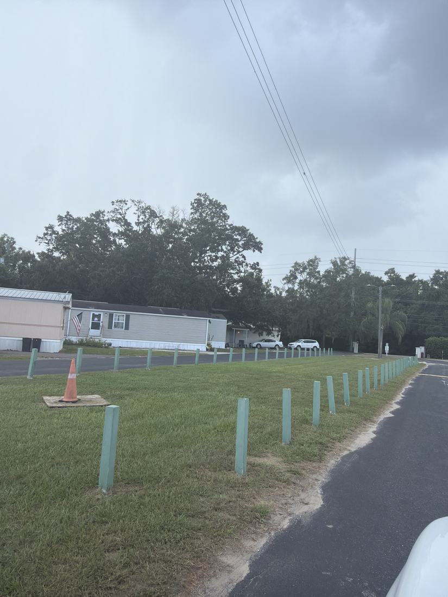

- Individual street signs for TC

  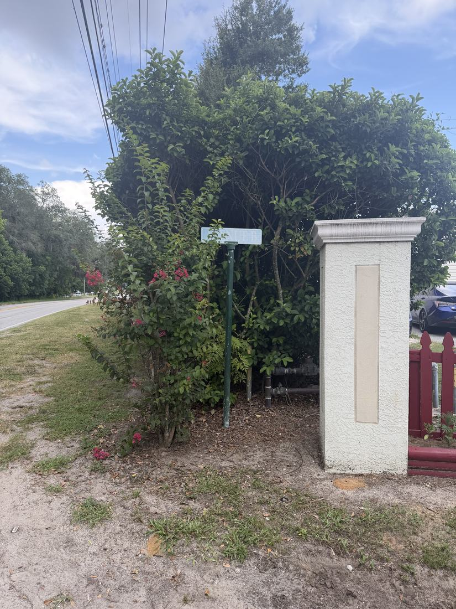

#### Resident Issues & Enforcement

> Residents use The Oaks pool and occasionally its clubhouse for parties on a $100 deposit applied to rent. Cameras are installed with controlled access; the access system needs to stay secure and authorization controlled.

#### Site Ops, Staffing & Equipment

> Trash overflow at Terrace Crossings is consuming significant staff time, four days a week of pickup. Individual cans are preferred over a dumpster because they are easier to regulate and cut cleanup. Trucks can access for pickup and waste management already collects yard waste. The $15,000 trash cost is charged in rent and tied to the rent increase timing, July here versus October at The Oaks.

### The Oaks (TO)

Thonotosassa, FL | 190 units | JREF II | RM AP (Alex Pontes) | 20 items

#### Capital & Infrastructure

- High white pvc fence around WWTP `SAFETY`

> Consensus to replace the chain link at the wastewater treatment plant with a 12-foot PVC fence, for security against teenagers accessing the area and for appearance as new homes go in nearby. Install before listings to avoid negative buyer impressions. Specs, vendor and schedule still to be set. `SAFETY`

#### Infill, Homes & Sales

> Three homes need rehab and crews are starting. Policy is no new incoming renters but renewals for existing, with effort to convert renters to owners. Legacy lease options from a prior purchase continue and about six have paid off; buyout options are worth evaluating to accelerate conversions. New homes planned with pricing not yet set.

> On-site familiarity is limited to in-house financing, with less experience of outside lenders. Connect the on-site team with the in-house financing specialist to guide prospects through applications and keep engagement in-house.

#### Curb Appeal & Site Standards

- Mailbox structure, painted etc

- Take this tree down by office `SAFETY`

  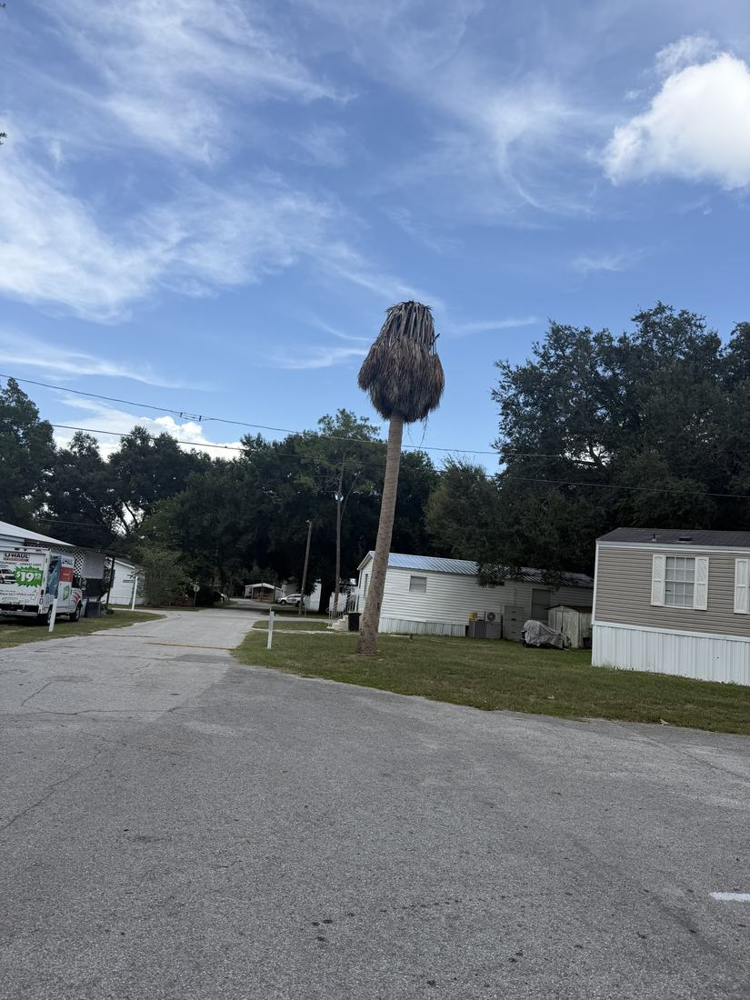

#### Amenities & Common Areas

- New bus stop (in house)

- Full screened in pavilion

- Full size basketball court

- Baby swing on swingset and whatever is on the other wood structure

> Favor expanding basketball with double hoops and re-striping over pickleball, on the view that pickleball interest is low. Pavilion proposed as half screened, half open like Paradise Lakes, with electrical service, to support events and manage mosquitoes. Site, design, permitting and budget not yet defined.

#### Resident Issues & Enforcement

- Lot rent credit for the mom managing community Facebook page. Sponsor lunch or tea for the mom’s group.

> Events include pool movies October to December, cookouts, biweekly bingo, a summer bash with glow sticks, and craft centers for Mother's and Father's Day. A committee of moms coordinates events and should get lunch or tea provided for their meetings.

#### Site Ops, Staffing & Equipment

- New maintenance shed and restocked tools

- Cans garbage

- Replace truck with gator

> Move toward individual trash cans here and at Riverwalk, aligned with rent increase timing (October here). Costs, rollout dates and resident communication still to be confirmed. `OPEN DECISION`

> Larger durable shed on a concrete slab needed to organize tools and materials, storing spare skirting, siding, PVC and fittings. Tool inventory is sparse since Eric left; compile and price a basic tool package.

> Positive inclination toward buying a UTV/gator for mobility and tasks like trash pickup, but no final decision, cost-benefit or procurement review. `OPEN DECISION`

> Timing is right to start next year's budgets.

### Windward Knoll (WIND)

Thonotosassa, FL | 168 units | JREF II | RM AP (Alex Pontes) | 6 items

#### Curb Appeal & Site Standards

- Trim palm trees

> Community sign out front, in the context of the I-4 corridor expansion. An August 27 meeting was noted. `OPEN DECISION`

#### Amenities & Common Areas

- Ping pong table

- New lights in the clubhouse - get rid of fluorescent

- Reupholster the clubhouse furniture (HOA can pay for it)

#### Resident Issues & Enforcement

- Can we ramp up sponsored events and the calendar? `OPEN DECISION`

---

## Notes on this report

- Plain list items are the site punch list exactly as written in the field, with the photo taken for that item directly beneath it.
- Blockquoted items are condensed from the AI notetaker summaries of the same visits: facts, figures, quotes and constraints only.
- Personnel matters, compensation discussions and individual resident hardship raised on the trip are deliberately excluded from this report.
- Regional coverage follows Natalie's regional map cross-checked against the Rent Manager coverage list. Region A = AG, Region B = AP, Region C = LS.
- Nalls Court does not appear in the regional map; it is filed under AG per the coverage list.
- Auburn Ridge is 160 units: 128 MH lots plus duplex apartments. The metering and sub-metering notes refer to the MH lots only.
- Photos live in the `photos/` folder beside this file. Keep them together or the image links break.
